# JARVIS

**A personal assistant and OS layer that runs across David's computers.** Say "Jarvis, …"
or type a request. JARVIS works out what you meant, does it on the right machine, checks
that it happened and remembers it.

It runs on two laptops:
- The main is an ASUS Zenbook running Arch Linux and Hyprland. It holds the brain, memory, voice and console.
- A node is a Dell G15 running Windows 11. It runs jobs, can be remote-controlled from the main, and stays silent.

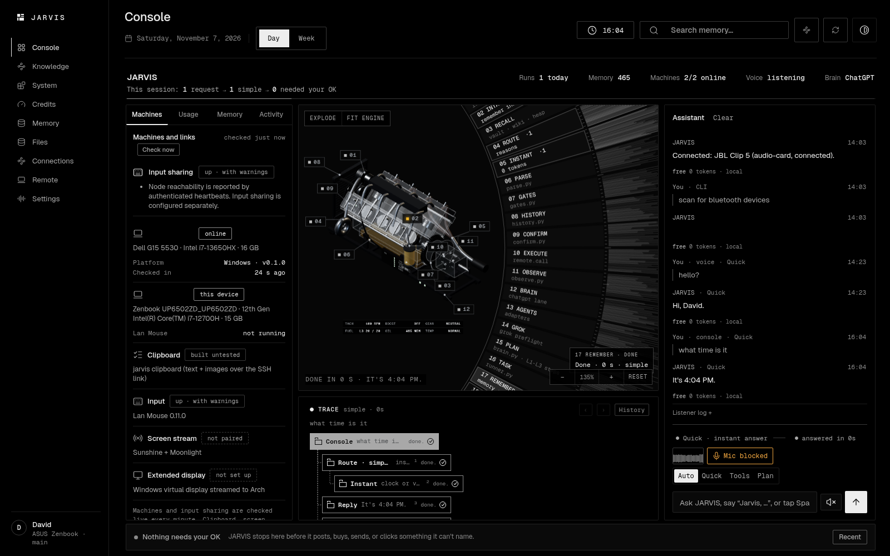

<sub>The console at `http://127.0.0.1:7777`. Left: machines and links. Middle: the
request engine and the trace of "what time is it", answered free in 0 s by the
instant-phrase step. Right: the assistant thread, showing what each reply cost.
Captured live 2026-11-07. "Mic blocked" appears only because headless Chrome refuses
the microphone.</sub>

## What makes it different

| | |
|---|---|
| **Free first** | Most requests never reach a model. Instant phrases and a strict rule parser handle them on the PC at no cost. The parser scores 0.990 and has made 0 wrong calls on the 199-case scorecard. |
| **Subscriptions only** | When a model is needed, JARVIS uses ChatGPT through the Codex subscription and fails over to the Claude CLI. It never uses pay-per-token API credits. |
| **Asks before it spends or sends** | Buying, paying and messaging as David wait in a confirm queue. A hard gate refuses credentials, wipes and edits to its own files outright. |
| **Sandboxed** | Brain terminal commands on Linux run in bubblewrap. Secrets, browser profiles and `.jarvis/` are hidden, and JARVIS's own code is read-only. |
| **One assistant, many PCs** | One main, light nodes. Nodes long-poll the main's hub over an SSH tunnel and only run code that passed the full test suite. |
| **Drive the other PC** | The Remote view streams a node's screen into the console and sends your mouse and keyboard back. No new port is opened. |
| **Knows your voice** | An ERes2Net voiceprint checks it's David. Parakeet transcribes, with Whisper as backup. Strangers' speech is dropped unread. |
| **Memory that cites** | SQLite memory combines BM25 and vector search. It reads the Obsidian vault (never writes to it) and keeps a knowledge engine whose claims carry sources. |

## Architecture

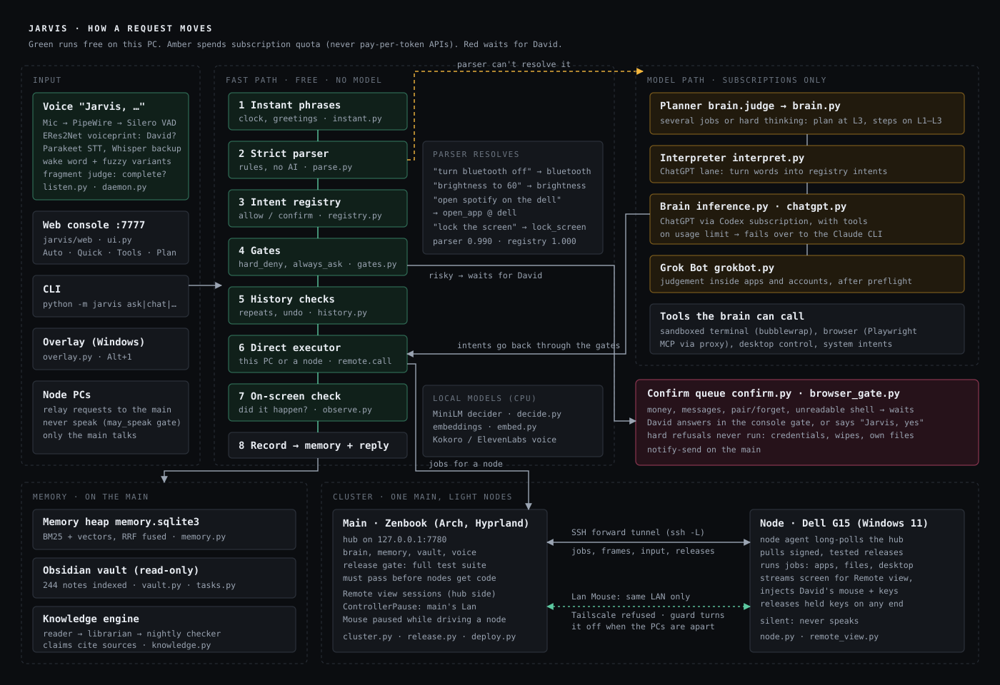

Every request, from voice, the console, the CLI or a node, takes the same path:

1. **Free fast path, on the main.** Instant phrases → strict parser (`parse.py`) →
   intent registry (`registry.py`) → gates (`gates.py`) → history checks
   (`history.py`) → direct executor (`remote.call`, on this PC or a node) → on-screen
   check (`observe.py`) → record.
2. **Model path, only for what the parser can't resolve:**
   - the interpreter (`interpret.py`);
   - then the brain (`inference.py`): ChatGPT, failing over to the Claude CLI;
   - Grok Bot for judgement inside apps and accounts.

   `brain.judge` sends multi-job or hard requests to a planner (`brain.py`, levels L1–L3).
   Whatever the brain decides becomes registry intents and passes through the same gates.
3. **Confirm queue** (`confirm.py`). Anything risky waits until David answers in the
   console gate or says "Jarvis, yes".

The full reference is in [docs/architecture-guide.md](docs/architecture-guide.md).

## Inside the console

### Under the hood: the System page

The System page reads every check live from the laptop. Anything amber or red comes
with the command that fixes it.

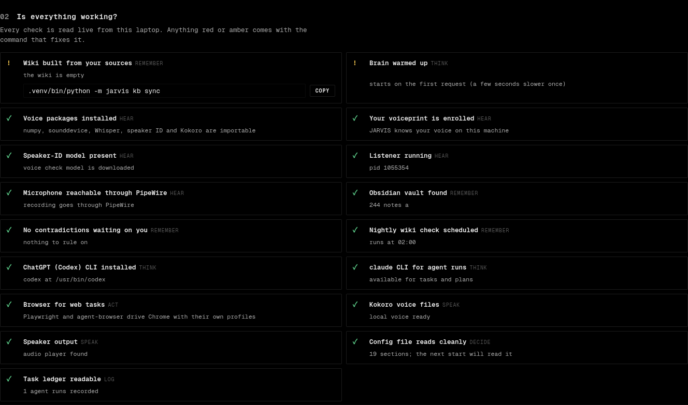

The **Under the hood** section shows each running component with its live numbers:
- the brain levels;
- the scorecard;
- gate policy;
- the terminal sandbox (143 paths hidden, 61 read-only);
- the cluster release, showing the node on the same code;
- the Lan Mouse guard.

Below them, every Python module is grouped by the step it belongs to, with its line
count and imports.

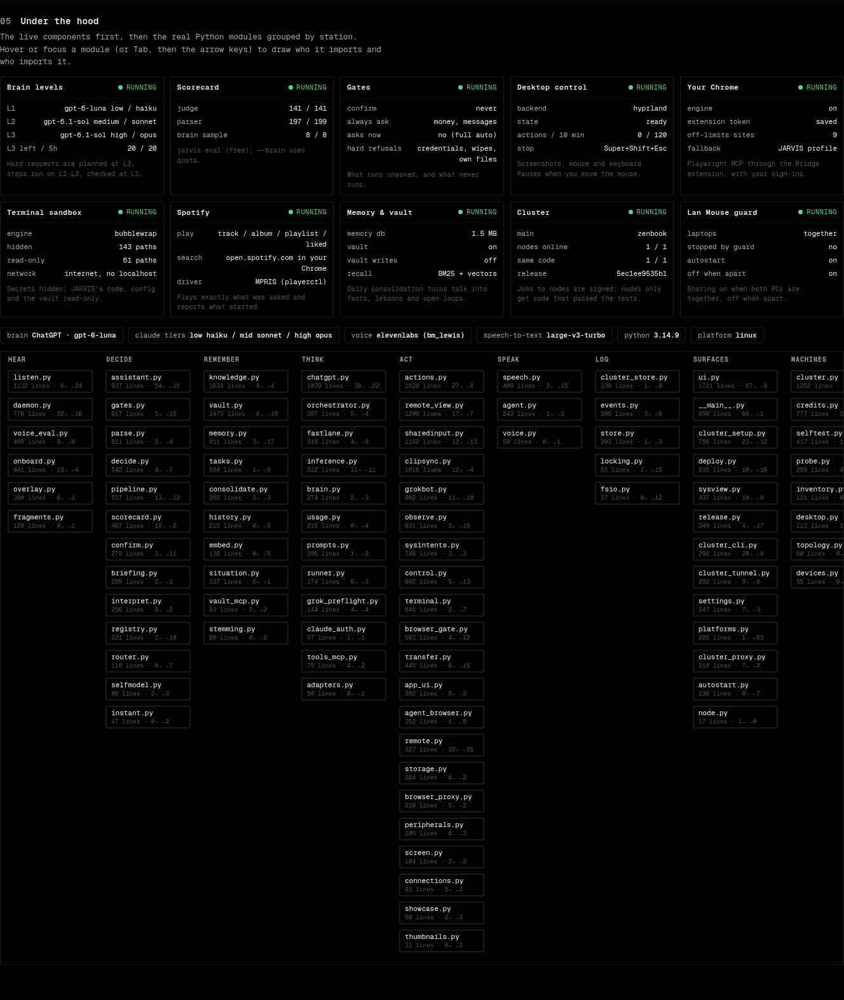

The request path is drawn as a live circuit board. Type a request and the board lights
the route it would take.

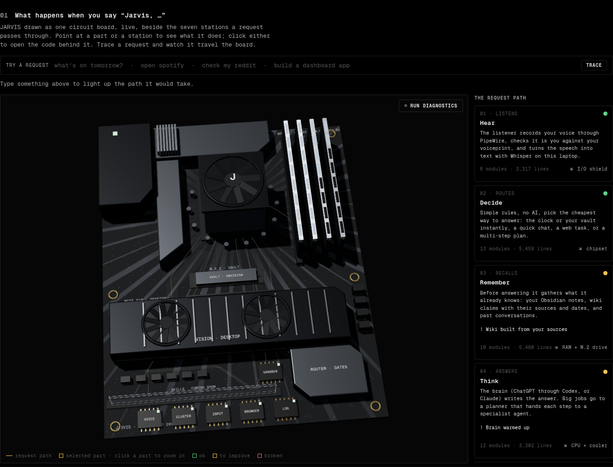

### Remote control: drive the Dell from the main

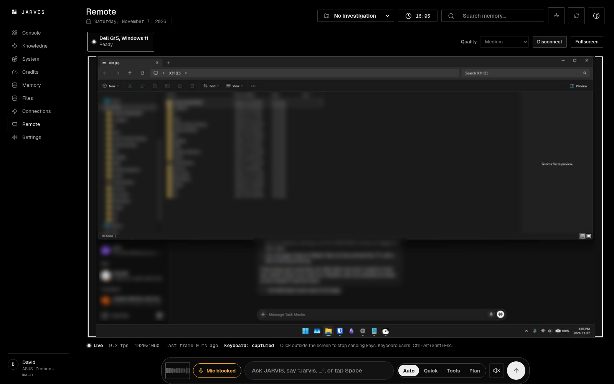

<sub>A real session to the Dell: Live, 9.2 fps, 1920×1080 source, last frame 0 ms ago.
The Dell's folder and chat contents are blurred for privacy. The session was view-only
and ended with Disconnect.</sub>

- **No new port.** Frames go node → hub and input goes hub → node over the existing
  SSH tunnel. Only the main's console can start a session, and the brain has no tool
  for it.
- **Nothing gets stuck.** However a session ends, held keys and buttons are released.
  That covers Disconnect, a closed tab, a lost link, `jarvis control stop` on the node,
  or a restart.
- **Your mouse stays home.** While you drive a node, `ControllerPause` pauses the
  main's Lan Mouse, so the pointer can't slip across to the Dell mid-session. Lan Mouse
  comes back afterwards, unless the laptops are apart.
- Quality presets: low (6 fps), medium (10 fps), high (15 fps).
  Ctrl+Alt+Shift+Esc releases the keyboard.

Details: [docs/handbook/remote-control.md](docs/handbook/remote-control.md).

### Machines and connections

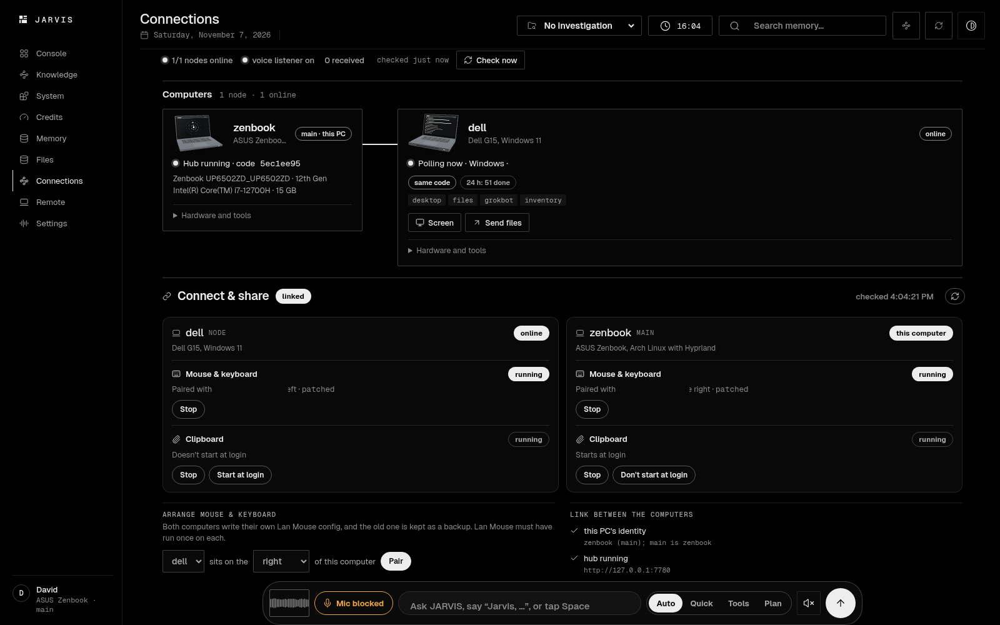

The Connections view shows both machines. In this capture, the hub runs code
`5ec1ee95`, the Dell is polling on the same code, and Lan Mouse and the clipboard run
on both sides.

### Knowledge engine

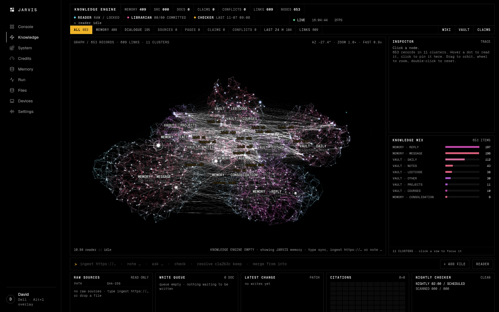

Memory and the vault are drawn as one graph. A reader ingests sources, a librarian
commits claims with their citations, and a checker runs nightly at 02:00.

### Memory, credits, files and settings

| Memory | Credits |
|---|---|
| 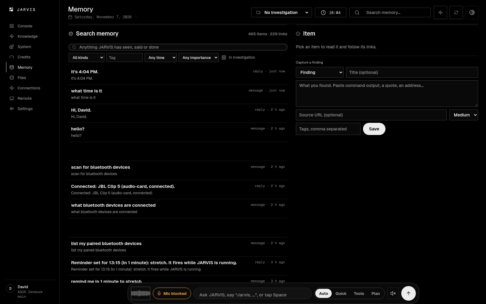 | 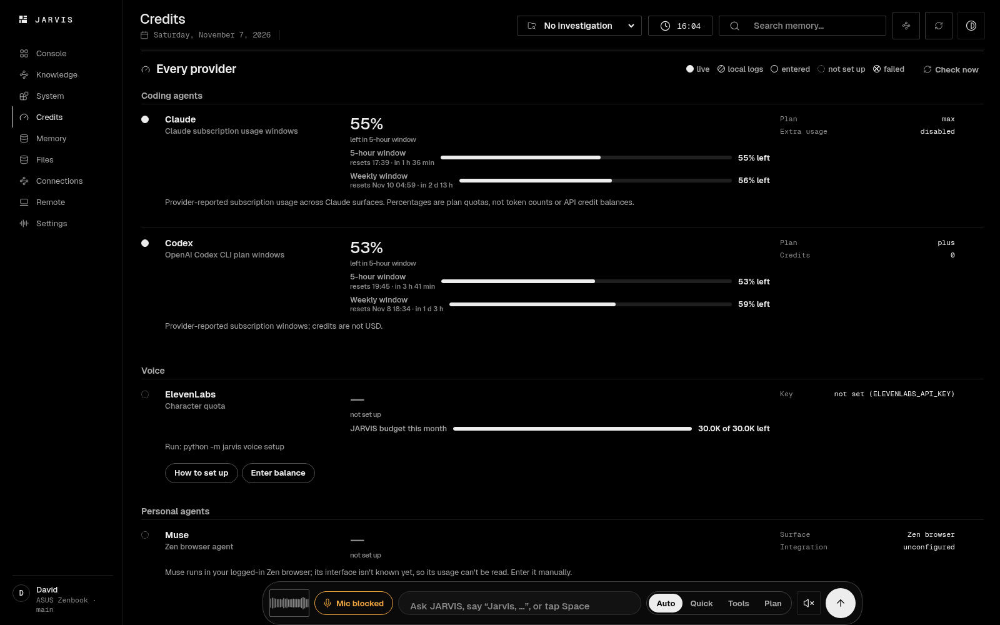 |
| Everything JARVIS has seen, said or done, searchable. | Live Claude and Codex subscription windows. No API balances are spent. |
| **Files** | **Settings** |
| 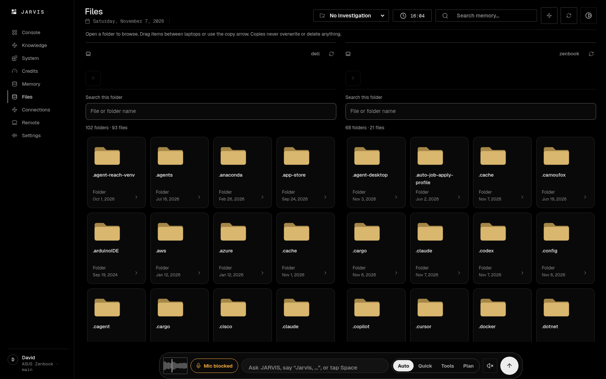 | 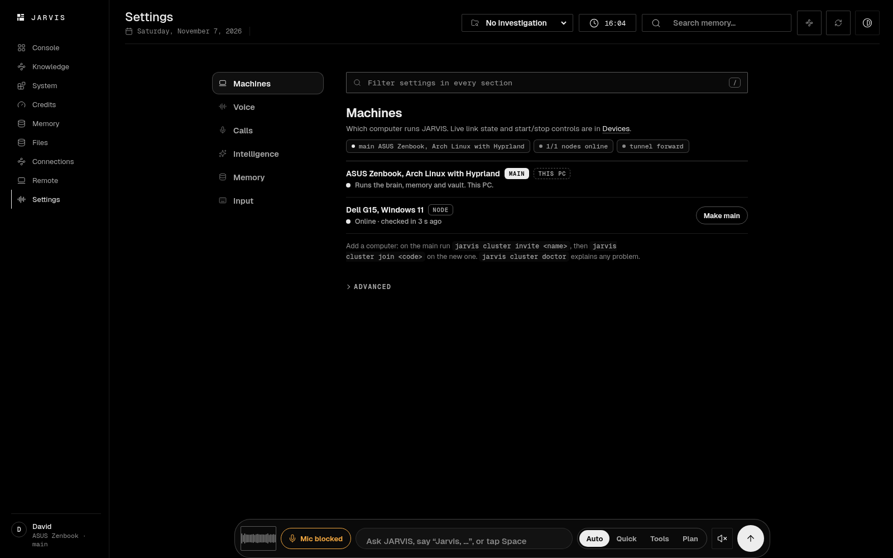 |
| Browse both laptops side by side and drag files between them. Copies never overwrite or delete. | Machines, voice, calls, intelligence, memory and input in one place. |

## Proof: real output

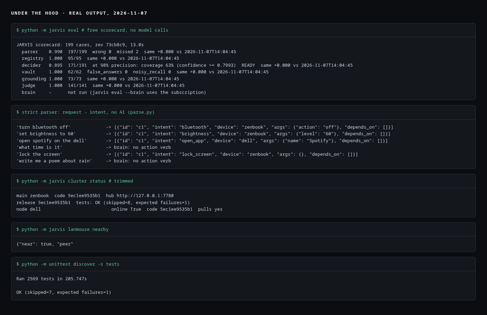

| Claim | Evidence (2026-11-07) |
|---|---|
| Requests resolve without a model | `jarvis eval`: parser 0.990 (197/199, **0 wrong**), registry 1.000, vault 1.000, grounding 1.000 |
| Bluetooth, brightness, lock and node apps parse directly | Strict parser output above |
| Nodes run only tested code | Release `5ec1ee9535b1` passed the full suite. The Dell reports the same code. |
| Lan Mouse only links on the same network | `lanmouse nearby`: the peer is on this network (172.1.43.16). Tailscale addresses are refused in the patched build. |
| The codebase is tested | `python -m unittest discover -s tests`: **2569 tests OK** (7 skipped, 1 expected failure, a known Lan Mouse fuzz case) |

Rerun these yourself. All of them are free:

```fish
.venv/bin/python -m jarvis eval                  # scorecard; --brain spends quota
.venv/bin/python -m jarvis cluster status
.venv/bin/python -m jarvis lanmouse nearby
.venv/bin/python -m unittest discover -s tests   # about 3.5 min
```

## Quick start

On the Arch main (fish):

```fish
uv venv .venv --python 3.12
uv pip install --python .venv/bin/python -e '.[voice]'
./start.sh                                        # voice listener + console window
.venv/bin/python -m jarvis voice autostart on     # start at login
```

On Windows, double-click `start.bat`.

Talk to it:

```fish
.venv/bin/python -m jarvis ask "turn bluetooth off"
.venv/bin/python -m jarvis ask "open spotify on the dell"
.venv/bin/python -m jarvis chat                   # type; replies are read aloud on the main
.venv/bin/python -m jarvis route "build a dashboard"   # dry run: which path it would take
.venv/bin/python -m jarvis voice enroll           # record your voiceprint
```

Cluster:

```fish
.venv/bin/python -m jarvis cluster roles          # who is main, which nodes
.venv/bin/python -m jarvis cluster update dell    # optional: releases go out automatically after a green push; this just speeds it up
.venv/bin/python -m jarvis cluster doctor         # diagnose either side
```

## Safety rules

- No pay-per-token API credits. Only the ChatGPT and Claude subscriptions and free local models.
- Money, messages, pairing and forgetting devices, and shell commands it can't read
  all wait for David's OK.
- Hard refusals never run: credentials, wipes and edits to JARVIS's own files.
- Text from web pages, the vault and agents is data, never instructions.
- No system-wide cursor or input change without a tested fail-safe. Stop desktop
  control with **Super+Shift+Esc** or `jarvis control stop`.

## Docs

| Read | For |
|---|---|
| [Handbook](docs/handbook/index.md) | Voice, remote control, input sharing, the cluster, the operations runbook |
| [Architecture guide](docs/architecture-guide.md) | The full reference, module by module |
| [Command and setup reference](docs/reference.md) | Every CLI command, Obsidian, the knowledge engine, Arch setup, hardware, ElevenLabs, the unified desktop |
| [Audit 2026-11](docs/handbook/audit-2026-11.md) | What the latest overhaul changed and why |
| [Feature validation](docs/feature-validation.md) · [Provider limits](docs/provider-limits.md) | Coverage matrix and quota sources |

`jarvis/web/` is the console (vanilla JS, no build step). `src/` and `index.html` are a
separate React/Vite website, not the console.
