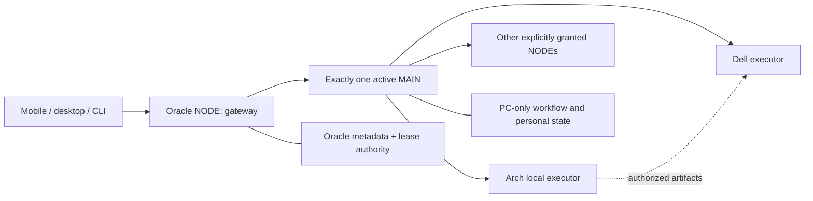

# Concurrent system and infrastructure architecture

This is a companion view of DESIGN.md; no infrastructure has been provisioned.

## 1. Topology and authority

Oracle gateway and metadata authority are initially one deployable with one SQLite writer,
not two MAINs. MAIN is a role on an eligible PC and may use that PC's local executor. Every
ordinary command follows MAIN; scoped peer artifact movement carries no job-scheduling rights.
Role recovery is the narrow authority-service path allowed when there is no MAIN. A public
internet endpoint/Funnel is not required: the initial gateway remains tailnet-only.

## 2. Concurrent lanes within a single-MAIN harness

| Lane | Owner and processing | Serialization / limit | Failure rule |
| --- | --- | --- | --- |
| Membership/lease | Oracle authority transactions | One active MAIN and one active transition/fleet | No promotion without authority; old permits drain/fence |
| Routing/auth | Gateway event handling | Proposed32 pending metadata operations/device; payload relay age10s | Backpressure/reject; no private disk spool |
| Workflow scheduling | MAIN scheduler plus private journal | One logical writer, event-driven; many worker tasks concurrently | Barrier/cursor before takeover; uncertain workflows pause |
| Interactive control | MAIN + target control lane | Bounded ordered input/session; reserve capacity ahead of batch work | Release on lost owner presence; no input replay |
| Target admission | Each target local transaction | Atomic resource/workspace reservation and receipt | Expired/wrong grants rejected; uncertain resources retained |
| Batch execution | Target-supervised processes | Start conservatively:1 batch task/PC,2 fleet-wide; measurable configurable limits | Pure tasks retry only after reconciliation; effects never blind-replay |
| GPU execution | Target runtime adapter | Initially1 admitted task/GPU resource domain; no fake aggregate VRAM | Require actual runtime/VRAM validation before enablement |
| Artifact transfer | Scoped authorized peer channels | Proposed2 transfers/fleet; chunk/rate/retention limits | Resume validated ranges; verify manifest before publication |
| Provider agents | Per-PC provider adapters | Initially1 session/provider/PC subject to provider quota | Mediated effects or unavailable; unmediated sessions stop on loss |
| Progress/usage | MAIN journals -> gateway transient relay -> interface | Cursor-based bounded event replay; numeric safe totals may persist | Missing private history reported, not fabricated |

These are proposed initial limits, not measurements of current capacity. Worker CPU/RAM budget
is the minimum of owner grant and actual available headroom (initially preserve25% RAM and
interactive scheduling capacity); never reserve more than physical resource domain permits.
Control handling must remain responsive while a long build runs. Replace the old single
blocking node-job loop with an independently responsive control/receipt channel and supervised
job processes, not an unbounded thread per request.

## 3. Concurrent job example

One MAIN may schedule independent Linux build and Windows test attempts simultaneously, then
run a report task after both results are committed. Each attempt has immutable inputs,
exclusive/isolated outputs, a local admission receipt and separate resource reservations.
MAIN scheduling decisions and global result commits serialize through its private journal;
actual compute is parallel. Both targets reporting success does not itself authorize duplicate
logical publication or a downstream task twice.

User-pinned target is a hard constraint. Auto placement must be explicitly selected for
cross-worker placement. A retry on a new target gets a new execution-operation ticket under
the same logical task, never a modified old ticket. No speculative duplicate external effects.

## 4. Physical processes and module layout

- Oracle: gateway/API and metadata/lease modules in one supervised service; local persistent
  metadata disk, bounded in-memory relays, encrypted off-VM metadata backup. No inference,
  prompt/file persistence, provider credentials or personal memory.
- Each PC: supervised fleet agent, transport/control lane, target admission and receipt journal,
  isolated executor processes; provider/state/coordinator modules enabled only by readiness.
- MAIN PC: additionally runs scheduler and the sole current workflow writer. Its OS effects
  pass the same executor admission as a remote target.
- Standby PC: verified personal/workflow replicas and separate provider login when authorized;
  it does not schedule new work without MAIN authority.
- Linux: supervised service + process groups/cgroups as required. Windows: background compute
  supervision and tested process-tree containment; desktop executor remains in interactive
  user session, never Session0.

Use proposed module facades from DESIGN.md rather than a big-bang rewrite: fleet/protocol,
transport, gateway/authority, coordinator/scheduler, executors, providers, personal_state and
runtime supervision. A module is not automatically a microservice. Cloud provisioning or
remote OS installation is excluded initial work; future destructive provisioning requires
separate grants, confirmation, recovery and cost approval.

## 5. Linearization and ownership

- Oracle serializes role changes and online consumption of MAIN-signed new-work admission.
- Target serializes resource/workspace admission and fsyncs its local effect receipt.
- MAIN serializes logical task/result/dependency commits in its private workflow journal.
- There is no atomic transaction across all three stores. Partial commits have explicit
  reconciliation states; admission, execution and observed completion are different facts.
- After planned writer freeze, candidate acknowledges the final barrier before continuing
  workflows. After abrupt loss without proof, affected workflows remain uncertain.
- Managed fleet-effect provider tools are broker-mediated per invocation. A normal CLI with
  independent shell/edit rights is not magically fenced by protecting Hub.dispatch alone.

## 6. Mobile-data and elevator outages

The phone need not share Wi-Fi with any PC; both need working tailnet connectivity. Direct and
relayed Tailscale paths differ in latency, so test actual cellular and relay conditions.
Persist the original request/ticket before submit. After a short loss: show Reconnecting,
restore authentication if valid, fetch existing operation/transition status by ID, then replay
missing progress events by cursor. No automatic new operation and no queued offline effects.
A provider/model timeout, phone network loss and target execution failure must be distinct UI
states. Keep unsent text as a draft, not an executable offline outbox.

Accepted bounded compute can continue while the phone has no signal, subject to MAIN/worker
authority policies. Interactive input stops and releases held keys/buttons; old batches are
never replayed. Camera view stops on owner-presence expiry (proposed<=15s), frames are not
recorded. Reopening permits explicit reattachment/start. Cancellation is not complete until
the target acknowledges stopping; a lost cancel reply is checked by its original ID.

## 7. Sizing and failure domains

Assumed1 owner,2 initial PCs,200 operations/day,2 streams. Control metadata is about24MB/month
at4KB/operation. A75KB frame at10fps is6Mbps and2.7GB/hour egress per stream. Gateway proposed
steady<1GiB/peak<2GiB must be benchmarked on the actual8GiB VM. Cap each compressed frame2MiB,
keep one newest frame per stream, and bound connection/chunk buffers; RAM is not a substitute
for admission/backpressure. No local LLM hosting is budgeted on Oracle.

Initial system tolerates a prepared PC failing, not loss of Oracle. Proposed15s leadership
lease/5s renew and prepared MAIN availability<=30s include clock/permit safety margins. They do
not guarantee recovery of an unsynced workflow. Backup restore may revive revoked identities:
owner accepted this risk; old execution leases/incarnations must still not revive. Mobile
cached shell availability is not authorization to execute while Oracle/MAIN are unavailable.

## 8. Boundaries and acceptance

One active MAIN; all other machines NODEs. No mobile location UI/API. Mobile MAIN management
requires separate admin grant/fresh passkey; it cannot approve ordinary risky OS actions.
Personal data remains on PCs. Cloud telemetry contains no raw task arguments, private DAG,
frames, credentials, source bodies or private result text. Provider budget/permission limits
are explicit; unknown cost is not zero cost. Additional paid compute, gateway HA and stronger
OS security boundaries need separate decisions.

Production evidence: two real PC attempts overlap; interactive stop remains responsive under
batch load; no resource double-booking; old managed tools remain fenced after reboot; final
journal barrier tests; cross-target retry identity test; real mediated provider invocation
on demotion; phone cellular disconnect/reconnect without duplicate effects. Diagrams alone
prove none of these.

Sources: [Tailscale connection types](https://tailscale.com/docs/reference/connection-types),
[MAIN handoff research](MAIN-HANDOFF.md#14-research-sources-and-what-remains-unconfirmed).
