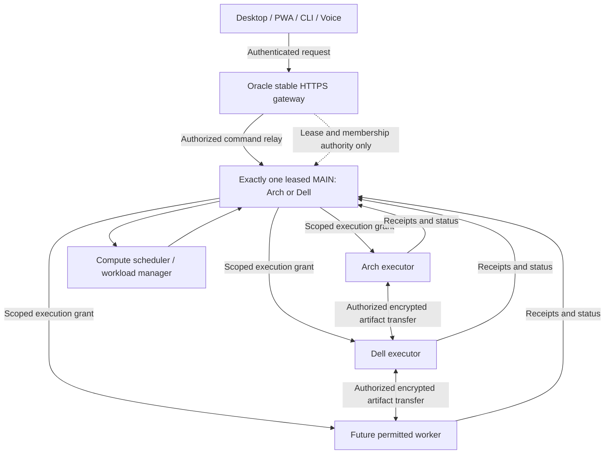

# JARVIS — Distributed Computer Harness

> **Status: Design proposal, not an implementation report.** This document consolidates the existing JARVIS modular fleet/mobile-continuity plan and extends it into a full distributed-compute harness specification. It preserves the stated privacy, identity, routing, lease, recovery, and user-consent boundaries. The new compute scheduler, resource fabric, and workload protocols are **proposed**, not known to exist in the repository. Authoring or accepting this document alone does **not** authorize source edits, account changes, credentials access, deployments, restarts, cloud provisioning, or paid services.

Companion views: [action plan](ACTION-PLAN.md), [concurrent architecture](ARCHITECTURE.md), [MAIN handoff](MAIN-HANDOFF.md), and [review history](REVIEW.md). All remain drafts.

## 0. Executive decision and system identity

**JARVIS is a modular, distributed computer and AI orchestration harness**. It presents one logical interface to a fleet of enrolled computers, while a **single active MAIN** coordinates operations, AI agents, task placement, remote execution, and results. Computers contribute **discovered and explicitly granted capabilities**—CPU, GPU, memory, storage, operating-system actions, agent runtimes, and local services—rather than becoming interchangeable superuser shells.

A **connected compute fabric** is a first-class requirement. Enrollment alone is insufficient: JARVIS must discover resource availability, select eligible execution targets, schedule independent workloads concurrently, move authorized task inputs/outputs, track durable results, and recover eligible work after failure. In v1 it provides **task-level distributed computing**, not an illusion of pooled shared RAM, automatically combined GPUs, or live-migrated processes. More sophisticated distributed model training/inference and cross-host memory execution are optional, separately designed runtimes.

The starting deployment is:

- **Arch Zenbook:** preferred MAIN, PC executor, AI/provider agent runtime, personal-state owner or replica as specified by state domain.
- **Dell Windows 11 PC:** executor and a **conditional, prepared** fallback MAIN; may provide GPU/CPU capacity and Windows-only capabilities. Promotion depends on actual readiness.
- **Oracle Cloud server:** an enrolled, **restricted NODE** hosting the stable mobile HTTPS gateway, authoritative fleet registry, pairing verification, metadata store, and lease authority. It is **not** an AI coordinator. It receives no persistent personal memory, prompts, provider sessions, camera recordings, or file bodies. Future compute workloads on cloud nodes require separate capability grants and data policies.
- **Future machines:** distinct enrolled PCs, VMs, or cloud workers with scoped capabilities. More devices add computing capacity and task destinations, **not** additional independent MAINs.
- **User interfaces:** desktop, mobile PWA, CLI, and later voice. A client interface is **not** necessarily hosted on, or equal to, the active MAIN. Any authorized interface can address the fleet through the same control policy.

### 0.1 Non-negotiable invariants

1. **Exactly one MAIN holds new-work authority when coordination is available.** If no safe MAIN is established, ordinary fleet commands pause. No standby may invent a new lease.
2. **All ordinary fleet commands are coordinated by the active MAIN.** The canonical remote control path is `client → gateway (if remote) → active MAIN → target executor`; the MAIN's own executor must pass the same checks. Oracle is never an alternative ordinary dispatch authority.
3. **Control-plane routing and heavy data movement are separate.** A MAIN-authorized, scoped peer-to-peer data transfer is permitted for large artifacts, but does not create a second command path or allow a NODE to accept unauthorized new jobs.
4. **Physical resources are not implicitly merged.** Resource aggregation means *scheduled use of a fleet*, not shared-memory or transparent GPU pooling.
5. **Capabilities are least-privilege and two-sided.** A node's self-reported capability is usable only if also granted by the owner, allowed by policy, compatible with the request, and currently ready.
6. **Oracle remains a control-plane metadata host, not a personal-data store.** It can transiently relay authorized traffic in RAM and is not claimed to be zero-knowledge; persistence and logging restrictions still apply.
7. **Personal AI state resides on PCs.** Provider logins/sessions remain local to each eligible PC. State replication is PC-to-PC, versioned, consented, and domain-specific. The owner's personal records (memory, conversations, command/task history) are canonical in the Obsidian second brain (desired state; see OBSIDIAN-CUTOVER.md for the staged cutover, whose completion gate is not yet met); credentials, authority, receipts and indexes stay PC-operational.
8. **Authority is fenced by epoch, expiry, operation identity, and executor-side checks.** Coordinator changes never justify replaying an uncertain external effect.
9. **Risky operating-system actions require an authorized PC approval station.** Phone pairing and `manage_main` do not grant dangerous-action approval; camera and screen control retain target-local permissions and visible consent/stop affordances.
10. **The user can choose a target independently of the MAIN.** MAIN placement, default target selection, personal file ownership, and gateway hosting are separate concepts.
11. **No location product on mobile.** No Locations/Radar tab, Locate action, map link, phone geolocation API, coordinate cache, or mobile location response. Existing non-mobile location features are outside this specific removal.
12. **Incremental extraction and reversibility.** One maintained package, versioned interfaces, a small number of supervised processes, staged migrations, tests, and explicit rollback—not an immediate rewrite or premature microservices platform.

### 0.2 Vocabulary

| Term | Precise meaning |
| --- | --- |
| **Device / installation** | One machine-specific, cryptographically enrolled JARVIS installation with a stable UUID. Not an IP, hostname, username, OS, or Tailscale identity. |
| **MAIN / active coordinator** | The sole PC currently holding the valid coordinator lease. Interprets requests, resolves targets, schedules workloads, issues bounded grants, and reconciles outcomes. |
| **Preferred MAIN** | The user's saved priority/preference, initially Arch. Changing it does not instantly change leadership or target. |
| **Fallback candidate** | An explicitly eligible, healthy, protocol-compatible, provider-ready PC with a sufficiently current state checkpoint. |
| **NODE** | Every device that is not currently MAIN, including servers and PCs. May execute authorized accepted work or a scoped service. |
| **Executor / worker** | A target-local service that validates grants, accepts jobs durably, enforces OS/consent boundaries, runs capabilities, and records outcomes. |
| **Compute fabric** | Connected, authenticated devices plus resource discovery, scheduling, task execution, data movement, and observability. Not just a list of SSH connections. |
| **Gateway** | Stable mobile/web origin, session/pairing authentication, routed request/stream relay, and metadata API. In the initial design, hosted on Oracle. |
| **Lease authority** | Oracle-hosted transactional authority for leadership membership/epochs. Narrowly permitted to recover MAIN, never to dispatch general fleet work. |
| **Execution target** | The explicit device or resolved device pool selected to run an operation; independent of active MAIN. |
| **Capability** | Named, versioned operation or runtime class subject to an explicit owner grant and local enforcement. |
| **Workload / job / task** | A workload is a user-level graph of jobs/tasks; a job is a schedulable unit; a task attempt is one specific execution with a stable logical task ID and unique attempt ID. |
| **Operation ID** | End-to-end idempotency/reconciliation identity for an effect or request. It survives client retries and coordinator changes. |
| **Artifact** | An explicitly scoped input, output, or checkpoint moved/stored for a task; not automatic copying of a user's whole home directory. |
| **Approval station** | An enrolled, authorized awake PC where high-risk actions can be approved. Not interchangeable with mobile admin authentication. |

## 1. Product outcomes, explicit non-goals, and example journeys

### 1.1 Primary experiences

**A. One unified interface:** The user opens JARVIS on Arch, Dell, an authenticated browser, or the iPhone PWA. It displays fleet health, current/preferred MAIN, selected execution target, AI sessions, operations, workloads, approvals, and resource availability. If the MAIN changes, the interface origin and identity do not need to change.

**B. Distributed work:** The user requests: “Run two code-review agents, build on the Linux machine, execute the Windows test suite on Dell, and run an authorized local-model inference job on an eligible GPU node.” The MAIN decomposes the request into a dependency graph, checks capability grants/resource needs, schedules ready jobs, transfers approved artifacts, runs independent jobs concurrently, and provides unified progress and verifiable results. AI may propose a plan, but actual scheduling and authorization are deterministic system functions.

**C. Remote controls:** The user selects Dell on the phone and requests keyboard, mouse, desktop, or camera access. The gateway authenticates the phone; the MAIN routes a bounded control/session request; the Dell executor performs local checks and consent. No LLM interpretation is required for simple screen/camera controls.

**D. MAIN continuity:** If Arch sleeps, stops, or is partitioned, the stable Oracle PWA still opens. After lease expiry, a control-ready Dell can be **manually recovered** for supported typed controls (AI work additionally requires provider/state readiness) and later automatically promoted (when enabled and tested). Old MAIN grants fail closed. Existing eligible node work may complete without becoming an invitation for duplicate effects.

**E. Fleet expansion:** The owner enrolls another laptop/VM with a one-use invitation, approves its actual identity, grants a narrow compute role, and observes CPU/GPU/runtime readiness. The scheduler can subsequently place approved compatible workloads there without hardcoding the machine into orchestration logic.

**F. Failure honesty:** With both PCs off, the dashboard can show offline devices and incomplete work but must not claim to execute actions. If Oracle is unavailable, new remote requests and phone-initiated recoveries fail closed in v1; an explicit administrator PC-local procedure may restore service separately.

### 1.2 Non-goals for the first production deployment

- No automatic merging of CPU cores, RAM, VRAM, or CUDA devices into a single machine; no distributed shared memory, transparent process migration, or automatic tensor/model parallelism.
- No autonomous second MAIN, direct mobile-to-NODE ordinary commands, or peer-elected leadership without Oracle's authority.
- No live-migration of Claude/Codex/other provider sessions or their authentication tokens.
- No shell access or unrestricted remote Python-plugin execution solely because a device joined the fleet; any shell/agent runtime must be a separately granted, sandboxed or approval-gated capability.
- No general-purpose VPN replacement, internet-exposed arbitrary-control API, or cloning of a trusted console endpoint.
- No Kubernetes, Redis, CRDT fleet, distributed SQL database, new cloud subscription, or new provider subscription as initial requirements.
- No automatic cloud persistence of personal work or automatic paid compute provisioning.
- No guaranteed execution during loss of the gateway/lease authority; this design trades some availability for a clear one-MAIN safety guarantee.
- No location tracking in the mobile product.
- No gateway HA or multi-region failover in v1.

### 1.3 Source of truth and present implementation status

The existing repository was previously described as having **single-main coupling**; this is historical design context to verify against the current working tree before coding, not a new repository inspection:

- `jarvis/topology.py:identity` pins one MAIN; `cluster.Hub` starts only on it.
- `phone.py` depends on an in-process Console/Hub and a cookie bound to that host.
- Broker state is Arch-local SQLite; pairing is local JSON; session frames, traces, and Ask retry mappings have in-memory components.
- Nodes use MAIN-specific tunnels. Copying HTML to Oracle does **not** remove these dependencies.
- Primary documentation ownership: `docs/handbook/cluster.md` and `docs/handbook/phone.md`. No accepted failover ADR was identified in the prior review.
- `jarvis/` is runtime; `tests/` verifies it; `docs/` and `prompts/` provide contracts; `src/` and `public/` are supporting/frontend surfaces rather than the active phone endpoint; `jarvis-memory/` holds first-party memory documentation; `skills/` and `examples/` are supporting material; `jarvis.egg-info/` and caches are generated/dependency output.
- Previously observed uncommitted changes mean commit-only comparison is inadequate. Inventory the live working tree, installed services, configuration, and local runtime state in Phase 0.

**Nothing in this file asserts the new gateway, scheduler, resource registry, data plane, replication, or failover has already been implemented.**

## 2. Logical topology and command/data flows



The diagram separates **command authority** from **data transport**. Oracle authenticates and relays remote input but does not select a worker or issue execution grants. A file-transfer optimization can connect two permitted workers directly **only after** the MAIN authorizes an artifact-scoped transfer; the workers do not thereby become alternative schedulers.

### 2.1 Canonical pathways

| Flow | Authority path | Data path / remarks |
| --- | --- | --- |
| Mobile Ask or ordinary command | Phone → Oracle gateway → current MAIN → selected executor | Payloads may transit gateway RAM; no cloud persistence of private contents. |
| Desktop/CLI fleet action | Local interface → current MAIN → target executor | A local UI on a NODE still uses MAIN grants for fleet work; local standalone administrative maintenance is separately defined. |
| Target is MAIN | Client → MAIN → MAIN's local executor | Identical receipt, capability, epoch, permission, and approval gates. |
| GPU/CPU job | Interface → MAIN scheduler → target worker | Worker reads authorized inputs and writes scoped outputs; multiple independent jobs may run concurrently. |
| Large artifact | MAIN authorizes transfer; nodes validate signed scoped tickets | Prefer encrypted direct peer transfer where policy/network allow; else bounded relay/approved storage. Oracle may not persist file bodies. |
| Desktop video/control | Phone → gateway → MAIN (authorization/commands) → target | Session media may follow approved gateway/target relay paths while remaining bound to MAIN-authorized sessions and target consent. |
| Recover MAIN | Owner on phone/approved PC → Oracle role authority → eligible candidate | **Membership-only** lease transaction; no ordinary NODE work issued by Oracle. |
| Heartbeats and readiness | Each device → Oracle registry, plus authorized MAIN subscription | Health reporting is not execution authorization. |
| Personal memory sync | Authorized PC ↔ authorized PC | Authenticated, encrypted, domain-scoped; not stored on Oracle. |

**Connectivity:** Prefer outbound authenticated device connections to the stable gateway over inbound open ports. The transport interface must be able to use the existing Tailscale/SSH path as an adapter during migration, without tying device identity to a tunnel. Direct peer transfers may use the authenticated tailnet when feasible, but identity, scope, expiry, and authorization must be verified at the application layer. NAT, firewalls, intermittent mobile connectivity, and tailnet outages are expected failure conditions.

### 2.2 MAIN is a logical role, not a UI or physical master switch

The MAIN performs task interpretation, orchestration, target resolution, scheduling, policy evaluation, and result reconciliation. The UI may be running on any authorized device. The MAIN can delegate both CPU and GPU work and can itself contribute resources via the local executor. It must not bypass target consent or grant checks simply because the target is local.

Other machines can have multiple roles—executor, artifact worker, supervised local service, or expressly approved background workload—without being MAIN. Oracle's gateway/metadata role does not confer AI coordination eligibility.

## 3. Package structure, modules, interfaces, and state owners

### 3.1 Modular packaging policy

Maintain **one JARVIS codebase/package with independently testable modules and versioned interfaces**. “Modular” does not imply a network microservice per module. Initially Oracle runs gateway + broker + metadata authority as one deployable; each PC runs one supervised device agent and whichever executor/coordinator/AI modules it is eligible to host. Services start in dependency order, stop safely, and tolerate partial capability readiness.

Each new module must declare: its public interface/version, input/output schema, required capabilities, trust boundary, state owner, deadlines, resource use, failure behavior, tests, and rollback. Introduce facades around existing implementation before moving files or changing behavior; do not combine a mass file move with a semantic rewrite.

### 3.2 Module catalogue

| Module | Purpose | State authority | Proposed home / migration seam |
| --- | --- | --- | --- |
| Fleet identity and topology | Installation UUIDs, enrollment, aliases, OS/architecture, host type, role grants, compatibility and snapshots | Oracle registry; private device key stays local | `jarvis/fleet/identity.py`, `registry.py`, `policy.py` around topology/cluster |
| Versioned protocol | Typed authenticated envelopes, job/attempt IDs, capability negotiation, expiry, release validation | Shared definitions; no global mutable store | `jarvis/protocol/` around signed-job contracts |
| Transport | Connect/send/receive, Tailscale or outbound tunnel adapter, reconnect, backpressure, stream multiplexing | Per-device connection state | `jarvis/transport/` around cluster clients/tunnels |
| Gateway / mobile API | Pairing/session authentication, stable origin, command relay, transient streams, role APIs | Oracle-auth metadata only | `jarvis/gateway/` extracted from `phone.py`, **not** the trusted desktop console |
| Lease authority / membership | Coordinator epochs, expiry, compare-and-swap transitions, role operation journal | Single Oracle transactional writer | `jarvis/fleet/lease.py` or gateway control-plane module |
| Coordinator / request planner | Understand request, determine intent/target, acquire/lose lease, supervise agents and approved work | Current MAIN; lease issued by Oracle | `jarvis/coordinator/` around assistant/pipeline |
| **Resource discovery** | Report CPU/GPU/VRAM/RAM, disk, runtimes, load and reservations; validate freshness | Node reports; MAIN derives scheduling view; grant authority on Oracle | Proposed `jarvis/compute/resources.py` |
| **Scheduler** | Admission control, policy/placement, dependencies, parallelism, capacity reservations, fairness | Active MAIN, fenced by epoch | Proposed `jarvis/compute/scheduler.py` |
| **Workload manager** | Job DAGs, lifecycle, retries, checkpoints, cancellation, aggregation | MAIN task journal and target receipts; metadata subset on Oracle | Proposed `jarvis/compute/workloads.py` |
| **Artifact/data movement** | Manifests, hashes, authorized transfers, scoped caches, retention and cleanup | Approved PC/worker storage; no default Oracle file storage | Proposed `jarvis/compute/artifacts.py` and `jarvis/transport/streams.py` |
| Executors / workers | Local grants, durable admission receipt, process/OS task execution, progress and observed outcome | Each target's local receipt journal and consent state | `jarvis/executors/` around registry/actions/control |
| Agent/provider adapters | Claude/Codex/other provider readiness, local session start, process ownership, quotas | Provider credentials/session files on each PC | `jarvis/providers/` facade; no wholesale rewrite |
| Personal state | Memory, vault/context, settings, approvals, checkpoints, PC-to-PC replication | Domain-specific PC writer/replica | `jarvis/personal_state/` around existing stores |
| Policy/approval | Capability intersection, risk tier, approval station, camera/control consent, revocation | Grant policy at Oracle; enforcement at MAIN and target; target-local consent | `jarvis/policy/` facade around existing intent/approval registry |
| Supervisor/runtime | Role startup, service health, release and schema checks, draining and rollback | Per-machine service manager | `jarvis/runtime/`; reuse systemd and Windows startup |
| Observability | Structured metadata events, fleet/job metrics, diagnosis, privacy-filtered logs | Numeric cloud metadata; sensitive detail local to PCs | `jarvis/observability/` or current logging adapters |
| Presentation | Device selector, role management, Ask, sessions, tasks, compute dashboard, approvals, usage | Derived view models; server remains source of truth | Existing desktop UI and PWA using gateway contracts |

**Shared interface set:** `DeviceDirectory`, `JobBroker`, `LeaseAuthority`, `Coordinator`, `Executor`, `Transport`, `CapabilityPolicy`, `ResourceDirectory`, `Scheduler`, `WorkloadStore`, `ArtifactStore`, `PersonalStateStore`, and `ProviderSession`. Dependencies must be injected into modules, not resolved by reaching into an in-process `Console`, global `Hub`, or singleton. Fake/local/remote adapters must pass the same contract tests.

The **existing intent registry remains the central action definition**. No unrestricted generic import-and-execute Python plugin system or dynamic module import from network requests. New execution classes require signed/approved extension registration and explicitly defined interfaces.

## 4. Device identity, enrollment, grants, and role model

### 4.1 Stable identity versus mutable roles

A device registration should contain:

```text
device_id (stable installation UUID)
display_name, aliases, host_type (pc|server|vm|other)
os, os_version, cpu_architecture, device_class
public_device_identity_key, key_fingerprint
protocol_min/max, signed_release_identity
role_eligibility, owner_granted_capabilities, reported_capabilities
provider/runtime compatibility summaries
health, readiness reasons, last_heartbeat, last_fresh_resource_snapshot
optional owner-authorized resource labels and per-device policy
```

Never use IP, DNS, hostname, OS, or Tailscale machine identity as the authoritative device key. A device key is generated locally at enrollment and never copied from another installation. A renamed or re-IPed host should retain identity; reinstall/re-enroll needs an explicit migration or new UUID policy.

**Effective capabilities** are the intersection of owner grants, target policy, actual worker implementation, compatible protocol/release, current local consent/approval, and current readiness. Self-advertised GPU, shell, provider, camera, or network access is **not** a permission grant.

### 4.2 Role and capability defaults

- New PC: enrolled with narrowly scoped executor capability; not coordinator eligible until explicitly enabled and prepared.
- New server/cloud VM: identity and health only by default; **no** desktop, camera, shell, AI coordination, provider credentials, or unrestricted filesystem access.
- Arch: initial preferred coordinator, subject to lease and readiness.
- Dell: eligible standby only after provider, state, compatibility, and policy checks; may still execute approved jobs even when unprepared for MAIN.
- A worker can be temporarily unavailable for `gpu_inference` while healthy for `file_hash` or `build`; readiness is **per capability**, not a single binary online flag.
- A locked desktop may prohibit interactive control while headless work or AI coordination remains eligible if OS session, provider, and explicit policy permit it.

### 4.3 Enrollment and removal

**Proposed future commands—not current runnable CLI guarantees:** `jarvis fleet invite`, `join`, `status`, `grant`, `drain`, `remove`, `coordinator prefer`, `handover`, and `failover on/off`; later `jarvis compute devices`, `submit`, `status`, `cancel`, `artifacts`, `policy`.

1. From an authorized awake PC, create a one-use invitation listing allowed roles/capabilities and expiry (**default TTL 10 minutes**). Do not display secret material in chat, logs, or URLs that may be captured.
2. Install JARVIS on the new device and redeem the invitation over authenticated transport, using a fresh device keypair.
3. Display device key fingerprint, OS/host type, requested grants, and owner-confirmed identity. A credential copy or cloned Tailscale identity is never an enrollment shortcut.
4. Install the supervised service and probe protocol, CPU/GPU, runtimes, lock state, quota/provider readiness as relevant. Coordinator readiness is checked only for approved coordinator candidates.
5. Show precise states: `online`, `degraded`, `locked`, `incompatible`, `unprepared`, `draining`, `offline`, `revoked`; require a read-only probe before permitting mutating work.
6. On removal, drain accepted jobs where possible, end/terminate scoped sessions, revoke device credentials/grants, invalidate eligible leadership, invalidate artifact access, clean up reservations, and reject old reconnects. Hand over MAIN first where feasible; otherwise disable new AI/fleet requests. Revocation/grant-expiry target: **≤15 seconds** for active authority within connected healthy conditions.

Removing a device must not silently delete personal data or cached artifacts without an explicit retention/cleanup policy. Offline device wipe cannot be guaranteed; revoke network rights and record follow-up cleanup on reconnect.

### 4.4 Role policy

```text
preferred_coordinator: device UUID (initially Arch)
fallback_candidates: ordered eligible PC UUID list (initially Dell when prepared)
auto_failover: opt-in boolean, initially false
auto_failback: opt-in policy, initially false until tested
lease_renewal_seconds: 5 (target)
lease_expiry_seconds: 15 (target)
readiness_stability_seconds: 10–30 (candidate health gate)
preferred_return_stability_seconds: 30
approved_pc_stations: list of explicitly permitted PC identities
gateway_origin: stable Oracle origin, independent of preferred MAIN
```

`active_coordinator` is **derived from live authoritative lease state**, not a second manually edited host configuration. `execution_target` is request-scoped. `preferred_coordinator` must never be hardcoded to Arch in failback code.

## 5. Distributed compute fabric: resource discovery and capacity

**This section is the principal expansion missing from the previous continuity-oriented plan.** Fleet membership and ability to remote-control a node are prerequisites, **not equivalent** to an operative distributed compute system.

### 5.1 Resource inventory

Each permitted executor publishes a signed, bounded-freshness `ResourceSnapshot` scoped to what policy allows MAIN to use:

| Category | Discoverable fields | Scheduling interpretation |
| --- | --- | --- |
| CPU | architecture, logical/physical cores, available worker slots, load, supported instruction sets where relevant | Compatibility and reserved vs. usable CPU; never promise all cores are free. |
| Memory | total RAM, safe allocatable RAM, currently reserved/available memory, optional swap policy | Hard memory admission gates and headroom. |
| GPU | GPU count/identifiers, vendor/runtime, VRAM total/free/reserved, driver/runtime/toolkit compatibility, supported inference/build classes | Per-device GPU constraints; VRAM is not automatically shared across machines. |
| Storage | free disk, allowed scratch/workspace roots, cache capacity, space reservations, storage class | Artifact staging/checkpoint feasibility and cleanup bounds. |
| Network | reachability, measured RTT/throughput estimates, transfer path availability, allowed peers, bandwidth budget | Data locality and transfer-cost estimates; RTT is not physical location. |
| OS/tools | OS/version, CPU arch, compiler/interpreter/tool versions, containers, build chains, interactive session availability | Windows/Linux tasks and binary compatibility. |
| Agent/provider | permitted providers, CLI versions, login readiness, current sessions, quotas, model/runtime support | AI job placement without sharing login secrets. |
| Security | effective grants, approved workspaces, runtime isolation mode, approval requirements, current policy version | Hard eligibility checks, not scoring preferences. |
| Health/energy | last heartbeat, lock/suspend/battery/thermal constraints when permissioned, draining state | Avoid sleeping/unstable nodes; optional power policies. |
| Reservations | running tasks, committed and pending allocations, concurrency/queue depth | Prevent oversubscription and double booking. |

Do not upload arbitrary file names, environment variables, command lines, credentials, prompt text, desktop content, or sensitive process listings to Oracle as “telemetry.” Publish coarse resource data only where needed. Treat device reports as potentially stale or dishonest and verify quotas locally before starting a job.

### 5.2 Freshness and truth model

- Node snapshots have monotonic sequence, timestamp, device ID, signed release/protocol identity, capability-set version, and bounded TTL. Heartbeats every **5 seconds** are the initial reference cadence; expensive GPU/runtime probes can run less frequently.
- Oracle may store coarse capability/health/resource summaries but not private workload payloads. MAIN builds a live scheduling view by combining those summaries with direct worker acknowledgments and its own reservation ledger.
- A device is **not schedulable** merely because its latest heartbeat exists: require unexpired snapshot, allowed capacity, compatible runtime, local worker acknowledgment, and an eligible lease epoch.
- Reservations are made **atomically on the target** for constrained capacity, keyed by `(job_id, attempt_id, coordinator_epoch)`; MAIN's in-memory view is advisory until target admission confirms. This prevents two speculative placements from double-consuming the same GPU.
- Physical capacity counts once. Running multiple workers/VMs on the same host must either be modeled as disjoint granted partitions or share an identified physical resource domain to avoid false double counting.
- Policy may withhold hardware metrics or prohibit task placement while on battery, metered networks, remote sessions, thermally constrained hosts, or personal-work hours. Such controls are configurable, not assumed existing.

### 5.3 Compute modes and roadmap

| Mode | Initial expectation | Required engineering |
| --- | --- | --- |
| Single-host delegated execution | First compute milestone | Versioned job envelope, target executor, durable receipt, result. |
| Concurrent independent tasks across hosts | Core v1 goal | Scheduler, reservations, task graph, per-node queues, artifact transfers, result aggregation. |
| Build/test matrix | Early v1 workload | OS/toolchain constraints, immutable source snapshot/artifacts, reproducible attempts. |
| Separate AI coding agents | Core v1 where permitted | Provider adapter per PC, concurrency quotas, bounded workspaces, approvals, token/usage telemetry. |
| Local GPU inference on one worker | Supported when adapter/runtime exists | Model/runtime compatibility, VRAM admission, model/data locality and bounded process controls. |
| Data-parallel chunking | Later optional workload adapter | Explicit partition/merge semantics, deterministic chunk IDs, checkpoints and network cost analysis. |
| Cross-host tensor/model parallelism, distributed training, shared VRAM | Explicitly **not** a generic v1 feature | Dedicated framework, distributed runtime, high-bandwidth networking, synchronization, recovery and validation. |

The scheduling goal is **better utilization and parallel execution**, not a claim that JARVIS converts heterogeneous PCs into a single hardware address space.

## 6. Workload specification, DAGs, and execution semantics

### 6.1 Job model

A structured workload contains a stable `workload_id`, owner/caller, optional session/conversation reference **stored on PCs**, priority, deadline, budget, required approvals, task graph, declared artifacts, final-result aggregation, and cancellation policy. Each task contains:

- `task_id`, `operation_id`, dependencies and task type/capability version;
- explicit user-selected `target_device_id` **or** an eligible device pool/constraints (never silently override an explicit target);
- minimum/maximum CPU, memory, GPU count/VRAM, disk, expected runtime and network/artifact size;
- OS/architecture/runtime/provider requirements and approved workspace/sandbox;
- immutable input artifact IDs/digests, output declaration, checkpoint and retention policy;
- timeout/deadline, concurrency cost, priority/budget, and retry classification;
- human approval or physical consent requirement, if any;
- idempotency semantics: pure/replayable, checkpoint-resumable, externally side-effecting, or interactive/non-migratable;
- coordinator epoch, target admission grant, logical task ID, unique attempt ID, and trace/receipt references.

**Illustrative schema (design example, not an implemented CLI/API):**

```yaml
api_version: jarvis.compute/v1
workload_id: example-build-test-001
requested_by: owner
policy:
  priority: normal
  max_parallel_tasks: 3
  max_cost_usd: 0              # Prohibit new paid cloud execution
  on_unavailable: queue        # or fail; never silently buy capacity
  approval_mode: capability_policy
jobs:
  - id: build-linux
    capability: build.run/v1
    constraints:
      os: linux
      cpu_cores: 2
      memory_mib: 2048
    inputs: [sha256:SOURCE_ARCHIVE_DIGEST]
    outputs: [linux-build]
    retry: safe_if_pure
  - id: test-windows
    capability: tests.run/v1
    constraints:
      os: windows
      cpu_cores: 2
    inputs: [sha256:SOURCE_ARCHIVE_DIGEST]
    outputs: [windows-report]
    retry: safe_if_pure
  - id: report
    capability: artifacts.summarize/v1
    depends_on: [build-linux, test-windows]
    inputs: [linux-build, windows-report]
    retry: safe_if_pure
```

The schema example contains no executable arbitrary script or token. A real build adapter resolves approved repositories and commands through a defined runtime and allowlisted workspace, never by treating untrusted network content as code with owner-equivalent privileges.

### 6.2 Task lifecycle

```text
CREATED → VALIDATING → WAITING_FOR_APPROVAL/DEPENDENCIES/RESOURCES
        → PLACED → ADMITTING → ACCEPTED_DURABLY → RUNNING
        → CHECKPOINTING/STREAMING → SUCCEEDED
                                    ↘ FAILED / CANCELLED / TIMED_OUT
                                    ↘ RECONCILIATION_NEEDED
```

- `RECEIVED`, `ROUTED`, `ADMITTED`, `ACCEPTED_DURABLY`, `STARTED`, and `SUCCEEDED` are different assertions. Oracle's routing acknowledgment is **not** execution success.
- The target writes and `fsync`s a receipt **before** starting a side effect. Receipts bind `operation_id`, `task_id`, `attempt_id`, target UUID, payload digest, epoch, admission time, and current lifecycle. Target reserves capacity before or atomically with durable acceptance.
- Logical request/workload/task IDs persist across phone retry, MAIN transition and reconnection. A target-bound execution-operation ID and ticket identify one admitted execution. A replacement on another worker uses a new attempt AND a new execution-operation ticket under the same task; it is permitted only after prior effects/attempt commits are reconciled. Client retries of the same execution keep its original ID, ticket and age.
- The MAIN maintains a durable PC-side workflow journal/checkpoint. Oracle holds only redacted routing/operation metadata. A MAIN transition rebuilds scheduling state from the PC-side journal, target receipts and approved replicas.
- Long-running target jobs accepted before a MAIN transition may complete under their original accepted-work grant; **no new jobs** may be accepted using an expired or fenced epoch. Progress/result reporting after a transition needs a versioned reconciliation path.
- Timeouts do **not** imply cancellation of external effects. “Unknown whether executed” must be presented as `RECONCILIATION_NEEDED`; never replay a mouse click, purchase, command with side effects, or destructive operation on the basis of timeout alone.
- The initial design does **not** promise exactly-once effects in external systems; it provides at-most-once **admission per idempotency key at the executor**, durable receipts, and reconciliation. Truly exactly-once side effects require target-system cooperation or transaction semantics.
- Accepted work may be allowed to finish if the MAIN disappears; workers do not accept **new** ordinary fleet commands independently. New tasks require the succeeding valid MAIN.

### 6.3 Parallelism and dependency semantics

The scheduler only dispatches tasks whose dependencies succeeded according to their declared conditions. Independent branches execute in parallel across compatible nodes. Failed dependencies block or explicitly trigger alternate branches; a parent result cannot report success if required child receipts are missing. Fan-out and fan-in require stable identifiers, bounded concurrency, results/artifact manifests, and ordered status updates where ordering matters.

A user-selected target is a **hard constraint** unless the user expressly selects “Auto” or approves fallback placement. A generic request may target an eligible pool. If capacity is absent, queue with a visible reason rather than opportunistically running on an unauthorized cloud server.

### 6.4 Scheduling policy and admission

Use a deterministic, testable rule-based scheduler first; model-generated placement suggestions are advisory. The pipeline:

1. Validate authenticated caller, allowed workload class, safe action registry, risk/approval policy, signed release compatibility, and budget.
2. Resolve explicitly named target or discover eligible granted executors.
3. Filter by fresh health, protocol, required OS/runtime/provider, CPU/RAM/GPU/VRAM/disk, workspace, data policy, network reachability, and task isolation.
4. Filter for privacy and locality: a job containing personal state must stay on authorized PCs; a cloud node cannot receive it by default.
5. Estimate placement cost (queue time, input transfer size, data locality, capacity headroom, quotas, expected runtime, power preferences). Use measured RTT only as a **tie-breaker** when other priorities are equal.
6. Enforce per-owner/per-device limits: maximum parallel tasks, GPU slots, CPU/memory reservations, storage/network quotas, provider concurrency/token budget, and bounded queue depth.
7. Select deterministic best candidate; request an executor-side atomic reservation and durable admission under a current, scoped MAIN grant.
8. If admission races, fails, or capacity changes, release reservations and re-evaluate; never lie that a resource was allocated.
9. Update the workload journal and UI as target receipts arrive; release capacity on verified finish/cancel/failure.

Initial optimization objective: **correctness and policy first**, then predictable throughput, minimal idle capacity, reasonable transfer cost/latency, and resource fairness. Avoid preempting interactive desktop sessions for background AI tasks unless the owner explicitly enables that policy. A priority queue and per-device concurrency limits are sufficient for the initial personal fleet; cluster-wide autoscaling is not required.

### 6.5 Failure, retries, cancellation, and checkpointing

| Job type | Safe recovery |
| --- | --- |
| Pure, deterministic compute with immutable inputs | May retry on another eligible worker with a **new attempt ID and target-bound execution-operation ticket**, retaining the logical task ID after confirming old attempt stopped or cannot commit the result; deduplicate by logical task/result ID. |
| Restartable checkpointed job | Resume from verified checkpoint and supported runtime; never claim live-process migration. |
| Interactive desktop/camera session | Preserve at target when possible across MAIN changes; do not replicate controls or auto-replay input. |
| Provider AI session | Reconstruct context locally on an eligible PC using a verified replicated state cursor; never transfer live provider session/login. |
| File modification or deployment | Enforce path/version/approval checks; uncertain commit needs reconciliation, not automatic replay. |
| External side effect (email, purchase, click, destructive command) | At most one accepted effect per idempotency key; require target-system confirmation or human reconciliation after ambiguity. |

Cancellation is an explicit, authenticated request to the current MAIN and then the target; delivery, termination, and side effects are separately acknowledged. Support graceful stop, deadline, and owner-confirmed force stop within local safety policy. “Cancel requested” never equals “cancelled.” During MAIN loss, accepted worker tasks may finish; a separately defined local emergency-stop capability remains available on the target without pretending it is a fleet-wide scheduling command.

## 7. Artifact movement, workspace portability, and data locality

A multi-computer compute fabric requires task inputs and outputs to move **safely and deliberately**. Ordinary workload control still follows MAIN routing; bulk data can use a separate authorized data plane.

### 7.1 Artifact model

An artifact manifest should identify `artifact_id`, content hash, size, format/media type, originating device, owner, retention, access policy, approved destinations, encryption mode, and exact task references. Artifacts are immutable by default. Mutable project workspaces require explicit version/snapshot rules, not last-writer-wins synchronization.

- Task submission references **approved snapshots**, not arbitrary access to the owner's entire disk.
- Before execution, the worker obtains only authorized declared inputs, verifies size/hash, and places them in an approved sandbox/workspace.
- Outputs are written atomically to a staging area, verified, then committed as immutable result manifests. Only committed outputs satisfy dependent tasks.
- Direct PC-to-PC encrypted transfer is preferred for large files where reachable and explicitly allowed. Use a short-lived signed transfer ticket tied to sender, receiver, workload/task, artifact digest, direction, byte limit, expiry, policy version, and lease authority. A transfer ticket is **not** a command grant.
- If direct transport fails, an authorized transient relay may be used within bandwidth/retention caps. **Never** silently persist file bodies on Oracle. Temporary in-RAM relay is not end-to-end zero knowledge; encryption and endpoint validation remain important.
- Cache by content hash on approved nodes with per-owner isolation, size/TTL quotas, eviction, and revocation-aware access. Do not conflate a cache, a replicated personal vault, and an independent backup.
- Encrypt sensitive files in transit and at rest on permitted nodes; cryptographic key ownership stays with authorized endpoints, not publicly exposed cloud logs.
- Handle partial transfer, resume, hash mismatch, backpressure, quota exhaustion, disk-full, and disconnected recipient explicitly.

### 7.2 Paths and OS differences

Workspaces are logical IDs, not identical hardcoded filesystem paths across Arch and Windows. A workspace mount maps a workload's read-only inputs, writable scratch and controlled output directories to target-local paths. Windows path separators, permission model, interactive desktop session, and service-session restrictions require platform-specific adapters. Do not `rsync` a live SQLite file or mirror the complete `.jarvis` directory to make a node “portable.”

### 7.3 Bandwidth-aware placement

Place data-heavy work near permitted data when possible; compare expected transfer bytes against projected compute benefit and budget. Streaming outputs should use sequence numbers, flow control, bounded buffers, and resume cursors where supported. Progress events and numeric usage may be stored on Oracle, but raw prompts, source files, media, private outputs, and secret-bearing logs may not.

## 8. Agent orchestration and compute providers

JARVIS coordinates **both AI and non-AI** workloads. AI models may interpret user intent, draft a job DAG, suggest capabilities, or summarize results; model text cannot itself authorize a shell command, an OS action, resource over-allocation, or access to private files. Execution goes through typed capabilities, scheduler policy, target approvals, and receipts.

### 8.1 Provider/session constraints

- Install and validate each provider CLI/runtime **independently** on every eligible PC. A provider login on Arch does not imply Dell readiness.
- Do not copy browser cookies, OAuth tokens, CLI auth/session files, or live process state between devices.
- A MAIN handover starts a new local provider session and reconstructs context from verified available personal state. Missing unreplicated context is shown, not hidden.
- Respect provider session limits, rate limits, model availability, quotas, runtime/OS compatibility, and per-machine user approvals.
- Collect redacted **numeric** usage totals for budgets; session text, tokens, tool payloads, and credentials remain on PCs.
- AI work on future cloud servers is **not** enabled by joining them. Any such proposal requires a separate explicit cloud policy amendment; the initial Oracle role remains ineligible for AI coordination and personal-state persistence.

### 8.2 Agent job classes

Examples: code review, repository indexing, lint/build/test, documentation generation, static analysis, parallel research on approved public inputs, and local GPU inference when runtime support is installed. Coding agents must run within declared workspace, tool permissions, resource/time budgets, and approval policy. Agents may request child jobs through a bounded `schedule_subtask` capability, but every child is revalidated by the active MAIN, inherits or narrows parent grants/budgets, and receives an auditable child operation ID. No unlimited agent self-spawning.

### 8.3 Separation of concerns

**Coordinator:** decides *what authorized work should happen and where*. **Scheduler:** deterministically admits and places work based on resources and policy. **Provider adapter:** executes a model/agent session on its own host. **Executor:** enforces host-local action boundaries. **Gateway:** authenticates/relays, with no AI planning privilege. This split keeps model errors from becoming unreviewed fleet authority.

## 9. Protocol, authentication, authorization, and idempotency

### 9.1 Envelope contract

Typed versioned command envelopes carry at minimum:

```text
protocol_version, schema_version, message_type
operation_id, workload_id?, task_id?, attempt_id?, session_id?
caller_device_or_phone_id, target_device_id
active_coordinator_device_id, coordinator_epoch, grant_id
action_capability_name_and_version, policy_version
payload_digest, payload_size, expiry, nonce / sequence
required_approval_reference?, trace_id
cryptographic_authenticator / signed scoped grant
```

Use canonical serialization for signatures/digests. Verify authentication, audience/target, authorization, not-before/expiry, epoch, policy version, schema compatibility, replay/sequence constraints, and local capability/consent **before** durable admission and again before an irreversible effect if the policy requires it. Reject unknown fields that change security meaning; safe optional backward-compatible fields may have defaults. Avoid exposing full raw envelopes in cloud diagnostics.

The proposed acknowledgment states distinguish:

```text
GATEWAY_RECEIVED → MAIN_ROUTED → TARGET_RESERVED → TARGET_ACCEPTED_DURABLY
                → EXECUTING → OBSERVED_SUCCESS / OBSERVED_FAILURE
                → CANCELLED / TIMED_OUT / RECONCILIATION_NEEDED
```

Operation metadata stays on Oracle for **30 days** (proposed) and target dedup receipts for **90 days** (proposed). Expired operation IDs are rejected rather than silently reissued. A retained idempotency ledger is not by itself a guarantee against effects originating outside the executor.

### 9.2 Trust and signing

- Phone authenticates to Oracle's **new independent gateway**, not to a reverse-proxied trusted desktop console. Gateway verifies the caller and forwards narrowly scoped authenticated claims.
- MAIN proves current leadership through a lease/epoch grant issued by Oracle; worker verifies locally. Cloud gateway traffic by itself is insufficient authority.
- Device-to-device and device-to-gateway connections use authenticated encryption and local key custody. TLS/mTLS or equivalent application-level signed grants are implementation options subject to security review.
- Bind approvals, transfer tickets, resource reservations, and actions to target device, payload digest, operation ID, grant scope, expiry, and policy version; prevent cross-target replay and confused-deputy behavior.
- Grant revocation must be enforced even if UI is disconnected; short grant lifetimes and target checks bound stale authority. Proposed active revocation/grant expiry target is **≤15 seconds** under connected conditions; explicitly test network-partition behavior.
- Gateway compromise is a **high-impact risk** because it authenticates/relays remote actions; harden it to owner-grade standards, protect device identity keys, restrict administration, and do not claim the cloud relay is harmless.

### 9.3 Protocol evolution

Replace current exact-source-fingerprint coupling only **after** signed release checks, capability negotiation, and mixed-version tests are reliable. Deploy compatible readers before new writers; tolerate documented optional fields, not unsupported action semantics. Prevent MAIN promotion if the candidate lacks a required action/schema version. Legacy devices remain on an explicit legacy path until enrolled into v2; they appear `incompatible` with upgrade guidance rather than being silently accepted.

## 10. MAIN leases, selection, controlled handover, and failover

### 10.1 Authoritative lease protocol

Oracle's single-writer lease service maintains current leader device ID, lease epoch/incarnation, expiry, policy version, last valid heartbeat, idempotent promotion-operation records, and transition state. A coordinator renews roughly every **5 seconds**; expiry target is **15 seconds**. All executors—including the current MAIN's local executor—fence **new** work by epoch and grant expiry. No fallback worker can create or extend its own leadership lease if Oracle cannot be reached.

A **single active MAIN** is an authority invariant, not a promise that only one process physically believes itself alive. Network partitions can leave a stale process running; target-side fencing is what prevents stale processes from authorizing new fleet effects. Never restore an old lease as valid after a cloud database/volume restore.

**Candidate priority:** owner policy and hard readiness gates first; deterministic ordering, with measured RTT only as an optional tie-breaker. Stability target **10–30 seconds** before eligibility. An already prepared Dell should take over within **30 seconds of the last valid MAIN heartbeat** after lease expiry and validation; cold provider login or state repair may take longer. Report measured timings, not guaranteed claims.

### 10.2 Planned handover

1. Accept a signed, scoped `manage_main` request with expected epoch/policy version and idempotent operation ID.
2. Verify candidate identity, owner coordinator grant, signed release/protocol, provider readiness, health/resources, and personal-state checkpoint cursor.
3. Synchronize permitted PC personal-state domains; expose unsynced gaps before changing authority. Initial catch-up is insufficient: existing-workflow continuation additionally requires the final frozen-writer barrier in16A.11.
4. Drain the old planner's **new AI requests** for up to **15 seconds** where reachable. Distinguish finishing, cancelling, and reconciling operations; preserve eligible target-local long-running work and screen streams.
5. Atomically fence the old lease and advance the epoch at the authority; distribute the new scoped grant. Never permit two current leases. Every executor rejects stale **new work**.
6. Start a new local provider session on the incoming PC; do not hot-migrate provider tokens/process state.
7. Verify readiness through an end-to-end canary, commit role operation result, and only then optionally update the saved preference. On failed validation, retain the existing valid leader/preference. After an ambiguous mid-handover failure, recover using a **fresh** epoch; never revive an expired old grant.

A temporary **Make MAIN now** is not a saved preference change. **Set preferred MAIN** persists only after a validated planned handover. **Recover MAIN** waits for lease/grants expiry after lost contact; never offers a split-brain “force now” bypass.

### 10.3 Automatic promotion/failback

Initially opt-in and **disabled**. Start with shadow elections, manual handovers, and fault injection; enable automatic recovery only after phases and acceptance tests pass. When Arch regains health, require **30 seconds** continuous readiness and confirmed state catch-up before preference-driven failback. A user preference for Dell must be respected; code must not always return to Arch.

Do not resubmit accepted side-effecting work just because leader changed. A target-owned screen/camera session should survive coordinator change if its gateway/session bindings and target-local consent stay valid; reconfirm authorization as needed. New ordinary requests pause when MAIN is absent.

### 10.4 Recovery failure cases

- **Arch asleep/offline, Dell prepared, Oracle up:** manual recovery first; later auto-promotion if enabled. Same phone PWA origin and pairing remain valid.
- **Arch stale but still running after partition:** reject stale-epoch *new* work at every executor; old accepted jobs are separately reconciled.
- **Both PCs off:** authenticated dashboard and recovery explanations remain; no ordinary commands accepted.
- **No candidate ready:** explicit `NO_ELIGIBLE_MAIN`; identify provider, protocol, state, lock or resource reason; do not silently nominate Oracle.
- **Oracle unreachable:** no new phone commands, no new remote role changes, no new MAIN lease; already accepted work may complete within its accepted scope. Cached mobile UI may show **stale** status only.
- **Cloud restart/restore:** establish fresh incarnation/epoch, invalidate restored leases, reconcile membership/revocations, and reauthenticate/re-pair only if security policy requires. Never resurrect a revoked phone/device from an old database snapshot.
- **Manual local disaster recovery:** a separate authenticated administrator procedure on an authorized PC, explicitly requiring reconciliation and preventing autonomous two-MAIN promotion; not a covert automatic bypass.

## 11. Mobile PWA, desktop UI, and MAIN administration

### 11.1 Stable phone origin and pairing

Extract the PWA/static assets and independently authenticated phone gateway from Arch's in-process `phone.py`/Console dependencies. Deploy **one tailnet-only stable Oracle HTTPS origin** initially. Pair the phone with explicit owner approval from an enrolled awake PC (Arch need not be awake if another approved station is). A `__Host` cookie belongs to its hostname and **cannot** be copied/migrated between the Arch and Oracle origins. Treat the new phone installation as a deliberate one-time origin/pairing migration; the old Arch installation remains a separate legacy origin until safely deprecated.

Do not clone Tailscale node identity or proxy the trusted desktop console to simulate a stable gateway. The gateway independently verifies caller identity, issues authenticated scoped claims, and applies CSRF/session/cookie protections appropriate to the chosen origin and transport. Phone is an **interface**, not a privileged node scheduler.

### 11.2 Main screens

- **Dashboard:** active/preferred MAIN, connectivity, fleet summary, recent jobs, stale-status warnings, recovery state, bounded numeric usage.
- **Devices:** stable identity/name, host type/OS, last heartbeat, effective capabilities, current/available CPU/RAM/GPU/VRAM when permitted, active reservations, compatibility, provider readiness, and precise `offline`, `locked`, `degraded`, `unprepared`, `draining`, `incompatible` reasons.
- **Ask / Agents:** user-selected execution target is distinct from active MAIN; show agent sessions, child tasks, workspaces, token/cost budgets, approvals and results without misrepresenting remote execution.
- **Compute / Workloads (new):** eligible node capacity, queue and priority, DAG status, running attempts and target, transfer progress, estimated/actual usage, cancellation and retry/reconciliation status.
- **Sessions/Control:** selected device's allowed desktop, mouse/keyboard, camera, clipboard and file transfer capabilities; target-local permission, visible indicator, emergency stop.
- **Settings → MAIN (new):** current, preferred, candidates, why eligible/not, last handover, active transition, state-sync readiness, failover/failback preference, and clear error/cancel/retry states.
- **No Locations/Radar:** do not add map/location-related UI, link, browser geolocation call, coordinate cache, or location API to mobile.

### 11.3 Privileged role-management UX

Expose three distinct user actions:

- **Make MAIN now:** temporarily promote an eligible candidate; show whether later auto-return to preferred is active; do **not** silently change the preference.
- **Set preferred MAIN:** persist new preference only after successful validated planned handover.
- **Recover MAIN:** when current MAIN is unreachable, begin a lease-safe recovery; never force immediate dual leadership.

Before confirmation show candidate, availability, readiness, current/expected lease epoch, state-sync gap, impact on pending work, unchanged approval/camera rules, and rollback/reconciliation behavior. Require separate `manage_main` authorization and a **fresh passkey assertion** against a short-lived, single-use challenge bound to candidate, operation ID, action, policy version, and expected epoch. Ordinary paired-phone login does **not** imply fleet administration.

Initial admin grant and passkey enrollment require owner confirmation on an authorized PC. A separate authorized awake PC can initiate recovery when mobile admin credentials are unavailable. Neither route enables mobile approval of risky OS actions or overrides camera consent.

Proposed versioned APIs cover `GET role status`, `POST transition preview`, `POST fresh-auth confirmation`, and `GET/POST transition status/cancel` (illustrative semantics; **no committed route names**). Oracle records operations transactionally using expected-epoch checks and idempotency; the phone never edits `main_device`, carries a long-lived signing key, or commands a NODE to seize leadership.

Transition UI states:

```text
Requested → Checking readiness → Waiting for lease / Draining
          → Promoting → MAIN ready
or: Failed / Cancelled / Reconciliation needed
```

Disable competing admin actions during transition. If mobile disconnects after confirmation, status polling/retry must recover the **same operation ID**, never create a second promotion. Test concurrent phones, stale challenge/epoch, revoked admin, failed catch-up, locked candidates, missing provider readiness, and preference changes.

### 11.4 Persistent session experience

Keep request progress, job receipts and usage views tied to stable operation/workload IDs rather than the UI connection or MAIN process. Reconnection resumes status and allowed streams where possible; stale or lost status is labeled honestly. Camera and desktop sessions remain bound to the selected target, not silently re-targeted by MAIN handover. Physical camera consent and target-local stop stay effective after reconnect.

## 12. Personal state, replication, backups, and credential locality

### 12.1 Domain ownership table

| Domain | Authoritative writer and replication | Continuity behavior |
| --- | --- | --- |
| Personal memory / conversation / command and task history | **Desired state: the Obsidian second brain (`second_brain.root` namespace in the configured vault) is canonical.** Active authorized PC writer only (the current MAIN's archive drainer). Today (cutover stage C0–C1) SQLite `memory/history/tasks` stay the writable store and the vault is at most an exporter/mirror: **not** a completed cutover (OBSIDIAN-CUTOVER.md §0). Until the C3 gate passes, SQLite stays compatibility and migration source and no data is deleted. SQLite, FTS, vectors and `vault.sqlite3` become derived indexes plus an outbox spool. | Resume from the vault replica and verified barrier; display any unarchived gap (`archive_lag`) and any un-drained outbox on an unreachable MAIN. |
| Vault / documents / private files | Explicit home/write authority per namespace; version-checked approved replicas. The JARVIS archive namespace has its own write policy (archive writer, additive, never overwrites an edited note); interactive vault editing stays behind `vault.write` | Preserve conflicts as versions; never silent last-writer-wins full-file overwrite; user edits to generated notes win. |
| Settings and approved task context | Domain-specific authoritative PC writer and journal, with schema/version compatibility | Restore verified state, not an unvetted whole-directory clone. |
| Fleet role policy, pairing metadata, revocation and device registry | Single Oracle transactional authority, narrowly scoped | Validate monotonic policy/epoch; restored stale versions cannot reauthorize revoked identities. |
| Provider credentials, logins and live sessions | Local to each PC, separately provisioned | Validate readiness and start a fresh local session; never copy tokens/live sessions. |
| Target-local camera consent, control stop, paths, keybinds and desktop status | Target PC exclusively | Remain target-local across switch; not overwritten by replicated state. |
| Operation receipts | Executing PC append journal, redacted metadata mirrored to gateway | Query before retrying uncertain effects; no duplicate accepted admission. |
| Workflow DAG/checkpoints | Current MAIN PC journal with verified permitted PC replica; target receipts independent | Recover task dependencies/progress and label unsynced state. |
| Pending risky-action approvals | Approved PC station, bound to operation/target/digest/epoch/expiry | Re-present or cancel after invalidating failover; never implicitly approve. |
| Bulk artifacts and compute checkpoints | Authorized target PC/workspace or other explicitly approved worker storage | Hash-verified retrieval/retry under scope; no default Oracle persistence. |

### 12.2 Replication rules

Personal records (memory, conversation, command and task history) are canonical in the Obsidian vault once the cutover gate passes (OBSIDIAN-CUTOVER.md): each is committed to a same-database outbox with the mutation, then written by the single MAIN archive drainer; there is no atomic commit across SQLite and the vault, and the outbox is a spool, not canonical. Vault replication between PCs is a transport and cannot elect a writer; handover uses a drained-outbox barrier note plus digest verification. Credentials, tokens, locks, live authority, approvals/confirmations, execution receipts and rebuildable indexes stay PC-operational and are never written to vault bodies or Oracle. Use the SQLite backup API and domain-specific ordered change journals/checkpoints for the operational domains rather than copying a live database or whole `.jarvis` directory. Replicate only approved domains, with schema versions, integrity checks, authenticated encrypted channels, per-domain cursors, monotonic change indices, and explicit writer ownership. The **connected sync-lag target is ≤30 seconds**, not a guarantee of zero data loss on sudden crash. A standby proves its cursor equals a valid committed advertised checkpoint; merely seeing a recent timestamp is insufficient.

If the required state is missing, automatic AI promotion must not imply context continuity. Either defer promotion for AI readiness or show an explicitly **new/degraded conversation** with last available context while leaving restricted, permitted remote controls available through a valid MAIN. Store backup keys and personal-state restores on approved PCs. A replica is **not a backup**: maintain separate versioned/offline or independently stored PC backups and perform restore drills.

### 12.3 Approval preservation

Every high-risk approval binds operation ID, target, payload digest, epoch, scope, approval station, and expiry. MAIN failure may invalidate it; then require re-presentation/cancellation rather than treating a resent request as previously authorized. Phone remote administration does not confer approval-station privilege.

## 13. Security, privacy, consent, and threat model

### 13.1 Data placement contract

**Oracle may persist only:** paired-phone verifier/state, device IDs/public-key metadata, grants/revocation epochs, policy/lease versions, device/health and bounded resource snapshots, operation/workload IDs, deadlines/lifecycle/target, transfer metadata **without bodies**, and optional numerical usage totals. Keep any per-owner metadata partitioned; avoid raw personal names/paths in log fields if unnecessary.

**Oracle must not persist:** prompts, AI conversations, tool inputs/outputs, personal memory/vault, source/user file contents, camera recordings/frame bodies, credential/session files, shell secrets, environment secrets, or uncontrolled traces/crash dumps. This applies to DB, swap, disk caches, request logs, backups, and crash artifacts. The gateway necessarily processes transient command/media data in RAM, so this is **not** a zero-knowledge or end-to-end opaque hosting claim.

Proposed relay limits (subject to measurement): request relay age **10 seconds**, pending metadata **32 per device**, concurrent streams **2**, frame size **2 MiB**, **newest frame only** per stream under backpressure. No unbounded background streaming/storage.

### 13.2 Threats and mitigations

| Threat | Required defense |
| --- | --- |
| Stolen or unpaired phone | Strong pairing, independent gateway auth, revocation epochs, scoped session and MFA/passkey for role admin. |
| Compromised gateway | Minimize privilege and stored data, separate signing/lease trust, narrow dispatch relay, hardened updates, audit, rate limits, target-side grants. |
| Spoofed/rogue node | Per-installation keys, owner-approved enrollment, fresh capability intersection, signed releases and protocol validation. |
| Split-brain leadership | Single authoritative epoch, expiring leases, atomic promotion, executor-side fencing and partition drills. |
| Replay/duplicate effects | Stable operation ID, target fsynced receipt, payload digest, target idempotency, reconciliation before replay. |
| AI prompt/tool injection | Model suggestions are untrusted; typed action registry, explicit scope, approval gates, workspace sandbox and no implicit code execution. |
| Data exfiltration through worker | Per-task artifact manifests, path grants, domain privacy policy, egress controls, redacted telemetry, no automatic cloud placement. |
| Host compromise | Device revocation, bounded grants, local OS privilege separation, signed updates, minimize secrets copied. |
| Camera/desktop misuse | Target-local consent and visible indicators, lock policy, scoped session, stop control, bounded stream; no silent background camera activation. |
| Malicious plugin/update | Signed release validation, explicit allowlisted capabilities, no untrusted dynamic code imports. |
| Resource denial/oversubscription | Per-device atomic admission, quotas, task deadlines, concurrency caps, scratch cleanup and queue backpressure. |
| Snapshot/restore rollback | Advance authority incarnation/epoch, never restore leases as valid, reconcile revocation epochs. |

### 13.3 Safe remote execution

A “compute worker” is **not** synonymous with unrestricted remote shell access. Define a capability risk taxonomy: read-only inspections, sandboxed build/inference, approved project mutations, interactive desktop, credential-bearing operations, and destructive/high-impact actions. Risk tier determines allowable runtime, workspace, local privilege, approval, timeout, network reachability, and audit. Use OS-native isolation or containers where compatible, without assuming that a container alone is a complete security boundary. Remote camera and microphone access require explicit local consent and visible session status; the design does **not** provide covert capture or surveillance.

All cloud worker executions require explicit owner grants, privacy classification, cost limits, and provider/legal compliance. No node may delegate broader rights than it received. Review threat-model changes before enabling new compute backends.

## 14. Oracle persistence, operational capacity, and recovery

### 14.1 Storage and authority

Use a single Oracle SQLite writer in WAL mode with `FULL` synchronous commits for the initial bounded gateway, pairing, lease, job-routing metadata, and role-operation journal. This protects against a defined class of **single-volume process crashes**; it is **not high availability**. Keep authority state and data migrations transactional. Encrypt backups as appropriate, store **daily off-VM metadata backups**, and perform actual restore tests.

**Proposed disaster targets:** metadata RPO **≤24 hours** for a last daily backup, **<2 hours** manual restoration after infrastructure is available. Personal-state recovery comes from **PC backups**, not cloud metadata backup. Every restore invalidates previous coordinator grants and advances an incarnation/epoch before accepting commands. Membership/pairing/revocation state may roll back to the backup: the owner accepts that restored revoked identities may authenticate again. This does not authorize reuse of old coordinator leases/grants. Oracle Always Free instances may be reclaimed or have limits; verify the actual plan and off-VM backup reachability.

### 14.2 Sizing assumptions—not measurements

| Parameter | Planning assumption or target |
| --- | --- |
| Owner and fleet | 1 owner, 2 existing PCs, approximately 3 planned enrolled PCs |
| Control volume | 200 operations/day; 2 simultaneous streams |
| Heartbeats | 3 PCs / 5 seconds ≈ 0.6 heartbeats/second |
| Redacted metadata | 200 × 4 KB × 30 days ≈ 24 MB/month, excluding indexes/backups and variable overhead |
| Sample JPEG stream | 75 KB/frame × 10 fps ≈ 6 Mbps ≈ 2.7 GB/hour per stream |
| Two streams' illustrative egress | 2 × 60 stream-hours/month × 2.7 GB/hour ≈ 324 GB/month |
| Existing cloud target | 8 GiB Oracle VM **if verified available**; bounded gateway goal <1 GiB steady / <2 GiB peak, given CPU/network headroom |
| Remote control latency goal | Measure p95 input-feedback latency against **250 ms** |
| Prepared coordinator recovery | Target ≤30 seconds from last valid heartbeat, when authority and state are ready |
| PC state replication | Connected lag target ≤30 seconds, without zero-loss promise |
| Local active revocation | Target ≤15 seconds under defined connected conditions |
| Device invitation | One-use 10-minute default TTL |
| Lease | Renew ≈5 seconds, expire ≈15 seconds |
| Preferred failback | 30 seconds stable plus verified state catch-up; old planner drain ≤15 seconds |
| Cloud routing limits | Request relay 10 seconds; 32 pending metadata/device; 2 streams; 2 MiB frames; one newest frame/stream |
| Metadata/receipt retention | 30-day Oracle metadata, 90-day target dedup receipts (proposed) |

These are **illustrative capacity figures, not observed throughput, cost, or SLA**. The cloud VM is not assumed capable of hosting local LLMs merely because it has 8 GiB RAM. Profile CPU architecture, actual memory/disk spare, outbound/inbound bandwidth, regional RTT, network egress accounting, video codecs, and provider quota before deployment. Sustained live media may dominate cost far more than SQL job metadata.

### 14.3 Optimization gates

Measure remote input and media after the basic secure architecture passes. If p95 user-input feedback is **>250 ms** or relay egress is unacceptable, consider adaptive frame rate, codecs, direct target data paths, or WebRTC in a **separate measured change**. Do not add TURN/media clusters or WebRTC to Phase 1 solely for architectural elegance. Task placement should likewise optimize only after measuring queue time, CPU/GPU utilization, data transfer sizes, provider limits, and reliability.

## 15. Fleet lifecycle, supervision, and multi-server behavior

### 15.1 Per-host runtime

Start dependencies in order: local identity/config → transport → capability probes → executor → provider readiness → optional coordinator lease/roles → UI integration. Use existing platform supervisors: `systemd` under Linux; an appropriate Windows startup/session arrangement for Dell. In particular, **Windows desktop executor/interaction runs in the interactive user session, not Windows service Session 0**. A background service may supervise it but cannot use Session 0 as a surrogate for an unlocked desktop.

The supervisor must expose health/readiness separately; restart a crashed worker safely; prevent duplicate work admission from process restarts; drain on update; preserve receipt journals; and roll back a bad signed release. A node can be online for background compute while desktop control is unavailable due to lock/consent.

### 15.2 Additional cloud servers

Extra servers join as uniquely identified restricted NODEs, never a second MAIN or lease writer by default. They can become explicit compute workers, scoped artifact relays, or backup destinations **only after grants and a data/cost review**. They cannot silently receive PC memory, provider credentials, prompts, or owner-equivalent execution privileges. No assumption that a VM with SSH access is a safe personal-data destination.

### 15.3 Gateway migration and future HA

Initially **one active Oracle origin and SQLite writer**. Moving the gateway is a maintenance migration of origin, pairing verifier/metadata, and authority incarnation/epoch, with one active writer throughout. Do not run simultaneous SQLite writers over a shared filesystem or clone machine identities as a substitute for HA. Later gateway HA needs a stable external origin/router, supported authoritative replicated storage, fencing/restore testing, and an explicit cost/privacy decision. The first deployment tolerates a **PC failure**, not an **Oracle failure**.

## 16. Observability, budgets, and performance metrics

### 16.1 Operational metrics

Report per-device connection quality, last healthy heartbeat, role epoch/lease status, action compatibility, active capability grants, CPU/RAM/GPU/VRAM reservations, worker queue depth, scheduler decision/rejection reason, task wait/execution/transfer times, accepted vs completed job counts, retries and reconciliation-needed events, version mismatches, state checkpoint lag, failure/cancellation rates, gateway bandwidth, session count, p50/p95 remote input latency, and provider numeric usage/cost when available.

Use bounded cardinality and redaction. Personal commands, prompts, source contents, file paths, frame bodies, model completions, credential state values, and bearer tokens are **not** central metrics or cloud logs. Cloud metadata captures state transition IDs and safe reason codes, while detailed sensitive debugging remains on the authorized PC with explicit retention.

### 16.2 Resource and cost guardrails

Compute jobs need CPU/GPU reservation limits, max parallelism, scratch/disk quotas, artifact transfer limits, per-provider rate/token budgets, and explicit spend ceilings. Defaults should prevent unexpected paid cloud usage. A missing budget quote means **do not assume zero cost**; show unknown cost and require approval for charged services. Numeric utilization data must distinguish reported, reserved, and truly available resources.

## 16A. Integration review — controlling clarifications

These clarifications were added while integrating the owner-supplied specification into the
existing design. They qualify the sections above and the acceptance gates below. This is a
repository-grounded planning review, not an independent security certification or evidence
that the proposed modules exist. The canonical plan is this file; `design.json` carries its
structured summary. Approval remains pending.

### 16A.1 Separate control-ready MAIN from AI-ready MAIN

Phase 4's early continuity pilot must not depend on Phase 5B's complete AI/state replication.
A manually promoted, protocol-compatible **control-ready MAIN** may coordinate typed remote
screen/camera/control commands without model inference. It is still the sole MAIN, and all
ordinary requests route through it. It cannot accept AI/agent workloads without the additional
provider login, personal-state and workload-journal readiness gates. The UI must expose this
capability difference; control-only recovery must never pretend that AI context survived.
General automatic AI promotion retains the stricter Phase 5B/6 requirements. No second MAIN
is created for an unsupported class of work.

### 16A.2 Safe handover must account for already-issued grants

A new epoch in the Oracle database does not instantly fence an unreachable executor that
still holds a valid old grant. For planned transitions, obtain durable epoch-fence
acknowledgements from every affected executor **or wait until the maximum old new-work grant
expiry plus a defined clock-error margin** before activating the new MAIN. All new-work and
session-input grants must expire no later than the issuing leadership lease; a coordinator
cannot mint a longer-lived shortcut. Specify clock synchronization tolerance and conservative
monotonic local deadlines during protocol implementation; uncertain clock health fails closed.
The proposed 15-second lease and <=30-second prepared recovery targets must include this
safety margin, not be asserted independently of it. On restore, wait out surviving prior
grants as well as advancing authority incarnation. A test must partition an executor during
handover and demonstrate that no overlapping old/new new-work authority is accepted.

### 16A.3 Resource reservations follow real process state

Release a constrained CPU/GPU/VRAM/scratch allocation only after verified process exit,
verified cancellation, final result reconciliation or a target restart that proves its old
process/resource ownership no longer exists. A caller timeout, MAIN failure, lease expiry or
stale heartbeat is **not** proof that a GPU process stopped. Keep uncertain capacity reserved
or quarantine it; reconcile target-local process/container identity and receipts on reconnect.
Lease expiry prevents new admission; it does not reclaim resources from accepted running work.
Retrying a pure task needs a new attempt ID, and the former attempt must be unable to commit
the logical result before a replacement result is accepted.

### 16A.4 Recovery metadata is not a recoverable private workflow

Oracle's sanitized job IDs/lifecycle rows cannot reconstruct lost prompts, a full private DAG,
source artifacts or an AI conversation. Recover scheduling only from a verified PC-side
workflow checkpoint plus target receipts and artifact manifests. If the checkpoint is missing
or stale, show the missing scope and restrict recovery; do not generate a replacement DAG from
cloud metadata or automatically replay worker effects. Gate new dependent tasks on verified
inputs. This limitation remains even when the dashboard itself is available.

### 16A.5 Define the first releases without downgrading the compute requirement

- **Release A — continuity foundation:** modular seams, identity/protocol, enrollment and a
  stable mobile gateway; manual control-ready MAIN handover; phone -> MAIN -> Dell controls.
- **Release B — distributed-compute MVP:** actual Arch/Dell resource discovery and target-side
  reservations; concurrent Linux/Windows build/test or similarly safe jobs; dependencies,
  scoped artifact transfer, result verification and explicit-target/Auto policy.
- **Release C — prepared AI continuity:** PC-only state/workflow replication, provider-ready
  standby, authenticated mobile MAIN management, manual drills and then opt-in automation.

These are logical delivery gates, not calendar estimates or deployment authorization.
Resource/GPU discovery is part of the compute core. Executing a GPU inference workload
requires a separately enabled, tested runtime adapter; cross-host model/tensor parallelism
remains outside generic v1. Initial concurrency/queue/provider quotas must be set from Phase 0
measurements; preserve interactive-control capacity instead of allowing batch jobs to starve
screen stop/input. New paid cloud workers, personal-data cloud placement, provider
subscriptions and gateway HA require separate owner decisions. No prototype or mock-only
result satisfies the real cross-host acceptance gate.

### 16A.6 Owner-accepted backup revocation risk

Owner disposition (2026-11-11): accepted. A stale Oracle metadata backup can restore a phone,
node or admin identity that was revoked after that backup. The initial design does not add an
independent revocation authority or require universal re-enrollment to eliminate that risk.
Recovery instructions must show the restored backup time and advise reviewing/reapplying
post-backup revocations. Do not claim that those identities remain revoked across restore.
Still invalidate prior leadership grants/incarnations and wait out surviving grants before
issuing new MAIN authority. Accepting identity rollback does not accept dual MAINs or stale
action grants. This acceptance is a planning disposition, not deployment approval.

### 16A.7 Immutable original operation issuance and expiry

Choose authenticated original issuance, with receipts as additional protection. Before an
ordinary effect can be submitted, the authority mints a signed **OperationTicket** containing
server-generated operation ID, issuing incarnation, caller ID, intended target, payload digest,
`issued_at` and immutable `admit_until`. Initial proposed maximum admission/retry lifetime is
24 hours. The client retains the ticket and must present it for every retry. It cannot choose
or reissue a historical operation ID without its ticket. Payload/target changes require a
new operation; changing MAIN or renewing an execution grant does not renew the ticket.

Verification checks the original signature, caller, target, digest and original expiry before
looking up receipts. Reject an expired ticket even if both cloud metadata and worker receipts
have been compacted. Reject a retry that supplies an operation ID without its original ticket;
creating a genuinely new operation requires a new server-generated ID and a fresh explicit
user submission. If the original issuer key is retired or untrusted after restore, reject its
tickets rather than extending them. Clock uncertainty fails closed; protocol clock rules must
be aligned with the MAIN-handover implementation plan.

The 24-hour limit applies to **new admission/retries**, not forced cancellation of an accepted
long-running process. Bound a workload's scheduling lifetime initially to seven days; new
child operations receive their own tickets, while the PC workload journal prevents completed
logical tasks being scheduled twice. Keep receipt/result-commit records for the greater of
90 days after the attempt and 90 days after the workload's terminal state. Cloud routing
metadata may expire at30 days, but active workloads retain needed metadata until terminal.
No receipt lifetime creates an exactly-once guarantee for effects outside the executor.

Required test: run an effect, advance past ticket expiry, compact metadata and receipts, then
replay under a valid current phone identity and a fresh MAIN grant. Reject it without an effect.
Also reject changed target/digest, missing ticket and a refreshed ticket carrying the same old ID.

### 16A.8 Concurrent mutation workspace ownership

Every mutating coding-agent attempt gets an isolated worktree/sandbox from an immutable input
revision, or obtains an **exclusive workspace-write reservation**. Default: isolated worktrees
for Git-backed jobs; exclusive directory reservations for approved jobs that cannot isolate.
Hardware reservations alone never authorize shared checkout/index/output writes. Per-attempt
build outputs and scratch directories are separate even for nominally read-only builds.

A write reservation is target-local, durable and bound to canonical workspace/repository ID,
attempt and actual process identity. It remains held while a prior writer may still run,
including after MAIN failure or lease expiry. Shared common Git metadata operations must use
a repository lock; worktree isolation does not make Git's shared metadata independent.
Network-filesystem writes are excluded unless an independently correct lock/isolation contract
exists. Sandbox limits and path grants still apply; a worktree is not a security sandbox.

Agents publish changes as immutable patch/commit artifacts with base revision and digest; they
do not merge directly into the user's live branch or deploy as a side effect of success. The
MAIN collects results for owner review, then an authorized apply/merge operation checks that
the target revision is unchanged and runs validation under the workspace-write reservation.
Conflicts produce a reviewable conflict, never an overwrite. Discarding a failed worktree must
preserve logs/patches according to retention before cleanup.

Artifact publication writes attempt-local temporary files, computes/verifies a manifest, then
records the candidate artifact durably on the target. The active MAIN commits the logical-result reference in its private workflow journal using compare-and-set. A target-local CAS alone cannot arbitrate attempts on different machines.
Hash-addressed bodies may be uploaded more than once; only one attempt may commit the task's logical result through the current MAIN's verified workflow journal. If that journal/checkpoint is unavailable, result publication waits for reconciliation. Result-body delivery and metadata success are distinct. On handover, accepted
agents may finish in their existing isolated workspace, but cannot independently schedule new
fleet work or apply changes to the live project. Quarantine uncertain writers/results until
reconciled. Test two concurrent agents against the same repository plus MAIN failure during
publication: isolated outputs or queued exclusive access, no index corruption, one result commit.

### 16A.9 Per-entity structured schema authority

The previously generic repeated ownership/index definitions in `design.json` are superseded by
entity-specific tables. Each declares actual fields, primary/unique/index keys, foreign keys,
writer, acknowledgement point, retention and recovery source. Cloud tables contain only
control metadata; PC memory/workflow checkpoints and execution receipts acknowledge PC-local
journal durability, never Oracle WAL. An artifact digest in metadata is not its private body.
Validate every referenced key/index field and foreign-key target before rendering the report.
The detailed handover schema will be finalized alongside the dedicated handover plan; do not
mistake a provisional schema for deployed migration code.

### 16A.10 Dedicated MAIN-handover implementation plan

[MAIN-HANDOFF.md](MAIN-HANDOFF.md) is the controlling technical handover/cutover subplan.
It maps current effect entry points to proposed module ownership and H0–H8 delivery gates.
Its recommended initial v2 mode validates/consumes every new operation online with the
Oracle authority; this is authority validation, not cloud command scheduling. Input/media
sessions use bounded permits rather than a database transaction per frame or pointer move.
Original operation ticket age remains immutable. Offline new admission is not promised.

Persistent fleet/installation mode must prevent legacy local tools, CLI, voice, console,
owner-token Hub paths and startup from competing with v2 MAIN authority. Quiesce and disable
managed old processes/credentials before production cutover; old URLs may proxy or display
migration status, not authorize independently. Missing/corrupt/mismatched installation mode
after migration means quarantine, including alternate `--state` directories and managed
downgrades. A marker cannot stop malicious or unmodified old owner-privileged code: stronger
OS isolation remains a separate requirement if that guarantee is needed.

Suspension, hibernation, disconnect, reboot and authority restart invalidate cached role and
input authority. Revalidate online before new effects; choose tested suspend-aware elapsed
time adapters rather than assuming all monotonic clocks include sleep. Authority restore must
also fence the old authority service, not run a restored copy beside it. Accepted identity
revocation rollback remains the explicit exception in16A.6; old leadership grants still expire.

Handoff phases: inventory/test model; guard-aware compatibility release; isolated authority
prototype; production exclusive cutover; manual control-ready Arch/Dell handovers; AI/workflow
readiness; passkey-scoped mobile MAIN management; shadow/opt-in automation; controlled legacy
rollback drill. Before fencing a cancelled transition can leave the old valid MAIN active.
After fencing, failure may leave no MAIN; recover with a fresh epoch, never revive an old lease.
Activation distinguishes `GRANTED_NOT_READY` from ordinary command-ready MAIN.

Schema names in the subplan are conceptual aliases where appropriate: canonical structured
`FleetAuthority` is the earlier `Lease` entity, `WorkerReceipt` is its `ExecutionReceipt`, and
`WorkloadCheckpoint` is the PC `CoordinatorJournal` checkpoint. New `MainTransition`,
`ParticipantFence`, `AdmissionConsumption` and installation-local `AuthorityMode` contracts
are mirrored in design.json with their own keys, writers and durability points. None is
implemented DDL. Original 24h operation admission, seven-day workflow lifetime and precise
permit/clock limits remain proposed defaults pending implementation validation/owner approval.

### 16A.11 Final workflow barrier and unplanned-loss rules

Initial standby catch-up is preparation, not permission to resume a workflow. Planned handover
must stop new workflow mutations/admission on the outgoing MAIN, divert subsequent target results
to target-side retained receipts/artifacts, durably append a `HANDOVER_BARRIER` in the private
workflow journal, and freeze that writer. The barrier records outgoing epoch, workflow-set digest
and final journal sequence/hash. Replicate through that exact barrier; the candidate durably
acknowledges the matching cursor/hash before resuming existing workflows. No old writer may
commit after the barrier; late results reconcile through the successor, without child dispatch
from the old epoch. Coordinate this with executor/lease fencing and the `GRANTED_NOT_READY` gate.
Oracle may retain the barrier digest/cursor, never the private workflow body.

On abrupt loss without a verified final barrier, a previously synced prefix is not proof of the
old MAIN's final commit state. Mark affected active workflows `RECONCILIATION_NEEDED`; prohibit
retry, dependent dispatch and logical-result publication until PC journal/replica and worker
receipts prove the relevant state. If proof cannot be obtained, preserve uncertainty; the owner
can explicitly submit a new workload from new immutable inputs after seeing the duplicate-effect
risk, but this is not automatic recovery of the old workload. New independent typed commands
may use a control-ready MAIN; AI uses the available context with explicit limitations. The
prepared <=30s MAIN recovery target is not a promise to resume every interrupted workflow.

### 16A.12 Identity hierarchy for retries and concurrent work

Use request/workload/task IDs for logical intent. Use `(attempt_id, execution_operation_id)`
for a particular placement. The immutable OperationTicket binds that execution operation to
one caller, target, digest and original admission expiry. A phone HTTP retry or MAIN change
never refreshes or changes that ticket. A reconciled, policy-authorized cross-worker pure-compute
retry creates a new execution-operation ticket and attempt under the same logical task.
Previously issued tickets cannot be presented to another target. Explicit user pinning remains
a hard constraint; Auto placement is an owner choice. Side-effecting work cannot become a new
execution attempt simply because its prior result is unknown. The MAIN's verified private
workflow journal commits one logical result across all attempt targets; a target-local CAS
only protects local artifact candidates/receipts.

### 16A.13 Provider-process execution classes and demotion

Do not assume a provider CLI's shell/edit tools pass through Python's JARVIS guards. Initial
production **fleet-effect agent** support requires disabling its unmediated effectful builtin
tools and exposing an epoch/admission-checked tool broker instead. Each supported provider
adapter must demonstrate this restriction with a real tool-invocation harness; unsupported
providers remain unavailable for this execution class. Broker grants do not delegate the MAIN
signing key. Revalidate authority before each new child tool operation, including local OS tools.

A separately approved **bounded sandbox worker** can execute a fixed accepted job inside a
per-attempt workspace with no fleet credentials, privileged desktop access or default network
access. Continuing such accepted computation is not authority to create new fleet jobs. Scope,
process/container identity and actual enforced OS limits must be recorded. A worktree alone is
not isolation against network or owner-level filesystem access.

For unmediated legacy provider CLI sessions, demotion/disconnect/resume handling stops the whole
managed process tree (Linux cgroup or tested Windows Job Object equivalent) and preserves its
workspace. This is containment, NOT a guarantee that no tool ran before the watcher reacted:
mark in-flight effects uncertain and reconcile them. Do not enable this class where strict
per-tool post-demotion denial is promised. Killing a process does not undo an external effect.
No new agent tool dispatch occurs until a valid MAIN and the supported adapter are revalidated.

### 16A.14 Concurrent infrastructure and intermittent mobile connectivity

[ARCHITECTURE.md](ARCHITECTURE.md) defines the topology, execution lanes, ownership and concurrency
limits. [ACTION-PLAN.md](ACTION-PLAN.md) gives the controlling work packages, stage gates and
review status. These are views of this draft, not separate deployment authorizations.

A phone on mobile data uses its stable authenticated origin over the tailnet. Tailscale can
use direct or relayed connectivity; relay latency and provider egress must be measured. A brief
elevator outage neither changes MAIN nor automatically cancels accepted compute. The client
keeps immutable operation tickets/IDs and its event cursor, reconnects with capped jitter, and
queries existing status before resubmitting. Persist client request/ticket before submit so a
lost response/reload cannot convert a retry into a new operation. Never silently queue new
commands while completely offline; unsent text remains a draft.

Input safety differs from compute: lost connection/blur releases keys/buttons and closes or
expires the input permit; old pointer/key/text batches are not replayed on reconnect. Camera
viewing stops after its short owner-presence grace (proposed <=15s) or local consent withdrawal;
returning to the app requires an explicit session reattachment/restart. Discard stale frames,
keep the newest bounded frame only, and preserve the pairing unless revoked/expired. An
interrupted upload resumes only its authorized artifact ticket/ranges with integrity checks.
Connectivity loss is not execution failure or evidence that the target did nothing.

## 17. Controlling implementation roadmap and approval gates

The previous plan's *modular phases 0–8* remain the controlling order. New distributed-compute work is folded into the earliest safe phases; an extra per-phase milestone prevents “connected nodes” from being mistaken for completed compute orchestration. Each phase has acceptance evidence and rollback; a failed gate blocks promotion to the next phase. Full AI continuity is **later** than basic phone → fallback MAIN → Dell remote control.

| Phase | Deliverables and primary seams | Acceptance gate | Rollback |
| --- | --- | --- | --- |
| **0 — Baseline and contracts** | Inventory actual Arch/Dell/Oracle runtime, OS/CPU arch, spare memory/disk, Tailscale, current config and credential **locations only**, existing phone/control/provider flows, state stores and uncommitted code; record control/video latency; create failing fault-injection and resource-model tests | Current behavior, dependency graph, existing services and real resource constraints documented | Documentation/tests only; no runtime changes |
| **1 — Modular seams** | Facades/interfaces for topology, phone, cluster, executor, provider, state, scheduler/resource abstractions; separate origin/preferred/active/target/approval concepts | Same-process regression/parity tests; existing pairing/actions still work; no moved state/new ports required | Remove facade wiring; keep legacy implementations |
| **2 — Protocol and identity** | Installation UUIDs, typed/v2 signed envelopes, effective capability intersection, epochs/expiry, worker fsynced receipts, attempt IDs, transfer-ticket contracts, legacy adapters, mixed-version tests | Unknown identity/capability/schema/stale epoch rejected; idempotent admission; no uncertain side effect repeated; fake/real adapters pass | Disable v2 path for un-migrated users; preserve legacy path only for legacy operations |
| **3 — Enrollment, roles, resource reporting** | Invite/join/grant/drain/remove, readiness, measured CPU/RAM/GPU/runtime inventory, local reservation API, test-authority manual coordinator switching, scheduling-policy prototypes | New PC/server enrolls with minimum grants; snapshots are honest/fresh; overcommit rejected; manual switch in test fleet leaves one leader or none | Revoke candidate/resource grants; restore prior policy using **fresh** epoch |
| **4 — Stable Oracle gateway and basic control pilot** | Independent gateway/pairing, Oracle metadata/lease writer, outbound authenticated PC connections, MAIN-routed screen/control to Dell, redacted job progress; real phone PWA on stable origin | With Arch asleep, same Oracle PWA controls unlocked Dell after safe fallback promotion; both-off view truthful; camera and revocation maintained; no dual MAIN | Stop submissions, reconcile accepted IDs, return to retained Arch legacy origin without pretending cookies migrate |
| **5A — Distributed-compute MVP** | Deterministic scheduler, workload DAG, executor-side resource reservations reconciled against actual process state, 2-node parallel build/test or safe compute, result receipts, encrypted artifact transfer, user-selected target vs Auto, queue/usage UI | **Real Arch + Dell** run independent authorized tasks concurrently; dependencies wait; capacity/OS/GPU constraints respected; exact status and digests survive reconnect; no Oracle private payload persistence | Disable distributed placement; continue explicitly targeted single-host v2 execution; reconcile in-flight attempts |
| **5B — AI standby and personal state** | PC-local state adapters/ordered replication, verified checkpoints, Dell provider readiness, safe local session reconstruction, approval continuity, workload journal recovery | Dell answers with available verified context; missing data clearly labeled; no copied provider session/auth; private data not written on Oracle; missing workflow checkpoint limits recovery | Disable fallback AI eligibility; preserve PC journals/checkpoints; remain on one MAIN |
| **6 — Leases and opt-in automatic recovery** | Shadow election, manual handover drills, passkey-scoped mobile MAIN management, safe failure recovery and preferred failback, then optional auto mode | Partition/flap/crash tests prevent stale local/remote new work; prepared recovery target ≤30 s measured; mobile MAIN-off promotion and concurrent-admin tests pass | Turn automation off and pin an explicitly selected eligible PC via **fresh** lease |
| **7 — Operational migration/release** | One-time PWA origin migration, legacy deprecation, signed staged releases, backups/restore runbooks, telemetry, bandwidth/latency and capacity profiling, owner-approved soak | Real phone over tailnet controls Dell while Arch hard-off; metadata restore meets measured objectives; mixed-version update/rollback; no duplicate click; privacy audit | Reconcile all IDs before retiring legacy; preserve explicit recovery runbook and old path until agreed soak ends |
| **8 — Optional extensions** | Additional authorized cloud workers, data-parallel runtimes, specialized GPU inference, codec/direct-relay changes, or gateway HA only on separate decisions | Each extension has measured need, costs, privacy boundaries, failure tests and rollback | Disable extension without changing stable identity/job contracts |

**Dependencies and rollout guards:** Phase 3 may exercise manual roles with an in-process/test authority; production cross-host handover needs Phase 4's authoritative Oracle lease service. Phase 5A distributed jobs require v2 receipts, genuine executor resource reservations, and secure input/output transfer. Mobile `manage_main` ships only after identity, lease, state-readiness, and recovery safety are proven; full automatic failover follows Phase 6 tests. Basic phone-driven remote control and full AI/workload continuity are **different deliverables** and must not be falsely marked complete together.

### 17.1 Prior continuity-milestone rationale, now absorbed into roadmap

The earlier continuity milestones are preserved here as **rationale, not a competing work queue**:

1. Baseline and fault injection before service changes (now Phase 0).
2. Move mobile PWA and authenticated gateway to a stable origin without cloning cookies (Phase 4/7).
3. Make PCs independently reachable via outbound authenticated connections; retain target-local desktop/camera protections (Phases 2–4).
4. Persist cloud control metadata and target-local receipts, with private outputs never logged to Oracle (Phases 2–4).
5. Prepare Dell with separate provider login and PC-to-PC personal-state checkpoints (Phase 5B).
6. Shadow elections, manual promotions, preference-based failback and no replay (Phase 6).
7. Fault-injection hard-off/partition/restart and rollback soak (Phases 6–7).
8. Optimize relays/codecs only when p95 latency/egress justify it (Phase 8).

### 17.2 Readiness checklist before enabling any production compute capability

A module is not considered delivered until it has: schema/contract tests; local and remote real adapters; protocol/release compatibility checks; permission and revocation tests; deterministic failure/timeout behavior; resource/cost limits; privacy/log inspection; observable progress; documented rollback; and a real cross-host integration test. A simulated browser or mock worker alone does not certify the production fleet.

## 18. Verification matrix and acceptance tests

### 18.1 Fleet, identity, and MAIN safety

- Arch → Dell → Arch planned handover, then change saved preferred MAIN to Dell; the selected execution target and approval station remain unchanged.
- Hard-off Arch and partition Arch from Oracle/Dell; no two valid leaders; stale process attempts fail executor epoch validation **including local execution**.
- Cloud restart, delayed heartbeat, stale policy, revoked phone/device, expired lease, duplicate promotion request, and concurrent phones cannot resurrect old authority.
- Mobile `manage_main` tests: first passkey enrollment from approved PC, single-use challenge, wrong candidate, stale expected epoch, modified payload, revoked admin, lost confirmation reply, candidate locked/incompatible/unprepared, and failed state catch-up.
- 10–30 s readiness gate, prepared ≤30 s recovery target and 30 s preference failback plus ≤15 s drain are measured; unstable Arch flapping does not produce ping-pong.
- With no eligible MAIN, no ordinary fleet commands are admitted; with Oracle down, no remote recovery/commands; recovery reasons are actionable.

### 18.2 Worker and operation durability

- Crash coordinator before target acceptance, after durable target receipt, during external effect, and after effect but before result delivery; verify precise receipt/reconciliation behavior.
- Disconnect phone immediately after an app click; reissue **same operation ID** and never duplicate the click.
- Expired ID, stale epoch, altered digest, wrong target, revoked capability, lost grant, and mismatched protocol are rejected.
- An accepted target job finishes safely under old accepted-work scope or reports a definitive failure; it cannot accept new stale-epoch jobs.
- Cancellation requested versus cancellation completed is truthful; timeout of external action is reconciliation-needed, not automatically rerun.
- Windows desktop control runs in interactive session, not Session 0; lock/stop/camera consent take precedence.

### 18.3 Distributed compute—must be real, not a mock

- Arch and Dell advertise actual permitted CPU/RAM/GPU/runtime inventories; idle/busy/reserved figures remain internally consistent.
- Submit two independent jobs, one Linux-only and one Windows-only, and observe **concurrent execution** on their real respective workers, unified progress, and verified final artifacts.
- DAG dependency blocks its child until prerequisite outputs are committed and hash-verified; a failed dependency does not silently unlock downstream work.
- Hard-pinned target never migrates to Auto/fallback without permission; Auto placement uses only owner-granted, compatible candidates.
- GPU/VRAM admission rejects insufficient capacity, stale snapshot, missing runtime, and concurrent double-booking; release reservations after terminal state.
- Node loss during safe pure compute permits controlled **new attempt** only after reconciliation; externally side-effecting jobs remain unreplayed.
- Large artifact transfers survive interruption/resume without hash changes; wrong recipient/expired ticket/cross-workload access is denied; no cloud file-body persistence.
- Compute schedule and accepted job metadata can be reconstructed after MAIN promotion; missing workflow checkpoint is clearly shown.
- Budget, concurrency, scratch quota, bandwidth, and provider limits result in queued/rejected jobs with specific reasons, not hidden extra spending.

### 18.4 Personal-state and mobile correctness

- Memory change journal restores from cursor with integrity and schema validation; conflicting document edits remain separate, not silently overwritten.
- Obsidian cutover gate (OBSIDIAN-CUTOVER.md §9): fake-DB → vault → rebuilt-DB round trip, rebuilt DB serving live recall/history/task reads, vault-offline and crash fault matrix, user-edit/delete/conflict-copy handling, secret-redaction fixtures, no archive body or operational table crossing the vault/Oracle boundary, and no confirmation/grant created by rebuild. An exporter alone does not satisfy this gate.
- Provider sign-out, missing local CLI, locked workstation, stale release, and missing state cursor produce distinct readiness messages.
- No camera consent or local OS approval is copied or inferred during state sync/MAIN promotion.
- One stable Oracle PWA origin works through normal Arch/Dell switch; old `__Host` cookies do not migrate and legacy origin is explicitly deprecated.
- Request progress, numerical usage dropdown, stream ownership and operation IDs persist or truthfully reconcile after UI reconnect/leader change.
- Check source, runtime API, and compiled mobile bundle for **absence of mobile geolocation product surfaces**.

### 18.5 Security, backups, and reliability

- Review Oracle DB, logs, error traces, caches, backups, swap and crash artifacts to verify no prompts, personal files, credential/session files, raw tool output, or media bodies.
- Daily encrypted off-VM metadata backup restores in a measured exercise; restore increments incarnation/epoch and cannot revive old execution grants. Restoring revoked membership is an owner-accepted residual risk; see section16A.6.
- Prove target-local consent/stop, phone revocation, and grant expiry within the documented connected bound.
- Real phone via tailnet → real current MAIN → real Dell executor, with Arch powered off after safe promotion; simulated browser/unit tests do **not** satisfy this gate.
- Benchmark p95 input-feedback and video egress; document cloud cost, provider quota and 8-GiB-instance actual available resources before a release claim.

## 19. Alternatives and decisions deliberately rejected

| Alternative | Why it is not selected initially |
| --- | --- |
| PC-only floating MAIN with only two PCs | Partition safety plus autonomous failover requires an independent authority or sacrificing automatic availability. Migrating host-specific cookies/Tailscale identities is not a safe substitute. |
| Oracle as permanent AI MAIN | Violates the chosen locality boundary: personal AI sessions and memory stay on PCs; server default is ineligible for coordination. |
| Oracle proxy to existing Arch Hub only | Keeps the Arch-down failure point and in-process phone dependencies; cannot meet Dell-as-MAIN continuity. |
| Let any NODE dispatch jobs when MAIN disappears | Creates split-brain, unaccountable resource use and potentially duplicated side effects. |
| Run all jobs on one MAIN | Negates the desired connected distributed-compute harness and wastes available authorized workers. |
| Claim combined CPU/GPU/RAM automatically | Misstates physical isolation and network constraints; task-level scheduling is the correct v1 abstraction. |
| Whole-home or `.jarvis` synchronization | Copies host-specific secrets/consents, can corrupt live SQLite and violates per-domain conflict policy. |
| Copy CLI login/session tokens to standby | Unsafe and unreliable across hosts/providers; provision each eligible PC separately. |
| Gateway as arbitrary code executor or trusted console reverse proxy | Expands attack surface and defeats bounded typed-capability design. |
| Shared-file SQLite multi-writer gateway HA | Unsupported safety model for this use; choose single writer first, later design real replicated authority if needed. |
| Kubernetes/distributed DB/CRDT-first | Adds cost and complexity before a two-PC use case is proven. |
| WebRTC/media relay cluster in Phase 1 | Optimize only after measured latency or egress exceeds budgets. |

## 20. Open measurements, review questions, and decision record

### 20.1 Unverified baseline facts requiring measurement

- Oracle CPU architecture, OS, available CPU/RAM/disk, actual instance/free-tier and billing status, region, tailnet route/connectivity, backup plan, and network egress price/allowance.
- Actual Arch/Dell hardware resources, GPU/VRAM/runtime/driver state, provider CLI installation, provider logins, quotas, local agent environment, and idle/busy capacity.
- Current phone/desktop controls, pairing semantics, real stream frame size/fps, regional RTT, user-input p95, Oracle throughput and expected monthly stream-hours.
- Actual repository working tree and service boot flow; session/trace/Ask maps; all first-party personal-memory stores and which may be safely replicated.
- Which workspace directories and artifact classes the user authorizes for remote compute; which tasks are safe to retry; acceptable per-node CPU/GPU/energy/network policies.
- Whether any cloud workers beyond restricted Oracle are desired, with explicit cost and private-data policy decisions.
- Failure/restore times, replication lag under load, device revocation latency under partition, signed-release compatibility, and Windows interactive-session operation.

### 20.2 Architecture review / independent audit still outstanding

- Independent review of epoch fencing, resource admission and operation idempotency under network partitions.
- Full memory-store and credential-store audit to make PC-only state boundary enforceable.
- Security review of phone passkeys, role admin, gateway signing/claim delegation, artifact tickets, storage/log redaction, and high-risk OS approval chain.
- CPU/GPU scheduling, deterministic precedence, data-locality/cost model and `Auto` versus explicit target semantics.
- Operational restore drills and precise documentation of “available,” “queued,” “accepted,” “completed,” “cancelled,” and “reconciliation needed.”
- User decision on eventual cloud compute, local GPU inference runtime, data-parallel frameworks, and gateway HA **as separate opt-in features**.

### 20.3 Proposed acceptance decision

Approval of this **design** means agreement with the limited-cloud modular architecture; one active MAIN; Arch initially preferred; Dell initially fallback after real readiness; Oracle as stable gateway/metadata/lease authority and single failure domain; explicit computer-to-computer secure connectivity; **distributed resource discovery, scheduler and concurrent worker execution** as core capabilities; PC-only personal/provider state; MAIN-coordinated ordinary commands; phased implementation; and opt-in automatic recovery **only after** failure testing.

Approval does **not** authorize deploying code, accessing credentials, moving private data to Oracle, creating paid resources, adding provider subscriptions, enabling hidden camera/microphone access, or starting automatic failover before its gates. Gateway HA, advanced distributed model/tensor parallelism, new billable cloud workers, and migration of personal content to cloud are out of scope until individually approved.

**Decision status: DRAFT / AWAITING OWNER REVIEW.** The prior limited Oracle hosting boundary is accepted as the planning assumption; the expanded distributed-compute protocol and this full roadmap remain proposals. The historical single-MAIN coupling is a documented architecture constraint, not newly discovered debt. No runtime, account, service, credential or deployment changes were performed in producing this file.

## 21. References and authoritative documents

- Owner-supplied `pasted-text.txt` (2026-11-11), integrated with the existing modular fleet/mobile-continuity draft; integration clarifications are in section 16A.
- Integration review and boundaries: [REVIEW.md](REVIEW.md).
- Obsidian-canonical personal state, outbox, archive policy, tombstones and cutover slices: [OBSIDIAN-CUTOVER.md](OBSIDIAN-CUTOVER.md).
- Repository sources to re-verify in Phase 0: `jarvis/topology.py`, `jarvis/phone.py` (or present phone module), cluster Hub/clients, broker SQLite, pairing JSON, session/trace stores, `docs/handbook/cluster.md`, `docs/handbook/phone.md`, and tests.
- [Tailscale Serve documentation](https://tailscale.com/docs/reference/tailscale-cli/serve) — transport/origin considerations; configuration must be tested against current version before use.
- [Oracle Always Free resources](https://docs.oracle.com/en-us/iaas/Content/FreeTier/freetier_topic-Always_Free_Resources.htm) — actual allocation, limits and billing status require account-specific verification.

---

**Canonical one-sentence contract:** *JARVIS is a unified, secure, capability-based distributed computer harness in which a single leased PC MAIN orchestrates AI agents and ordinary operations across a connected fleet, schedules authorized CPU/GPU workloads on eligible nodes, safely moves only task-scoped data, and remains accessible through stable desktop/mobile interfaces without surrendering personal state or execution authority to the cloud gateway.*
