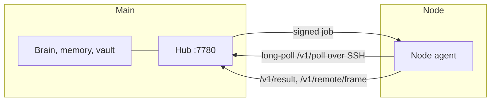

# Cluster

`cluster.main_device` in `jarvis.config.json` is the main: brain, memory, vault and the hub
on `127.0.0.1:<listen_port>`. Everything else is a node that long-polls the hub.

```sh
jq .cluster jarvis.config.json
python -c "from jarvis.platforms import detect; print(detect())"
```



## Config (`cluster`)

| Key | Default in code | This repo's value |
|---|---|---|
| `enabled` | `false` | `true` |
| `main_device` | none | `zenbook` |
| `tunnel` | `reverse` | `forward` |
| `listen_host` | n/a | `127.0.0.1` |
| `listen_port` | `7780` (`topology.DEFAULT_PORT`) | `7780` (7778 is the Grokbot tunnel) |
| `main_url` | `http://127.0.0.1:<port>` | `http://127.0.0.1:7780` |
| `auto_release` | `true` | not set |
| `ca_file` | none | not set |

Tunnel modes: `reverse` = the main runs `ssh -R` to each node (nodes need an SSH server).
`forward` = each node runs `ssh -L` to the main (only the main needs one).

## Commands

```sh
jarvis cluster roles
jarvis cluster main <id>
jarvis cluster init               # main, once
jarvis cluster invite <node>      # main; writes a file, refuses to overwrite one
jarvis cluster join <code>        # node
jarvis cluster doctor             # either side
jarvis cluster status | leave | revoke | caps
jarvis cluster update <node> [--rollback]
```

## Rules

- **After code changes nodes refuse mismatched code.** Run `jarvis cluster update <node>`.
  If a node is offline, say so and leave it. Do not keep retrying.
- Jobs carry the main's signature; nodes check it. Dispatched actions are never replayed.
- Nothing goes to the Dell unless David says it is available.
- A node is "alive" for 10 s after a check-in (`FRESH`).

## Clipboard sync

A watcher (`clipsync.py`) runs on each side; the cluster keep-alive restarts it if it
dies. Since the overhaul: `clipsync.stop()` leaves a marker so a stop by hand holds until
the next boot, and only one watcher can run per machine (`clipboard.lock`).
