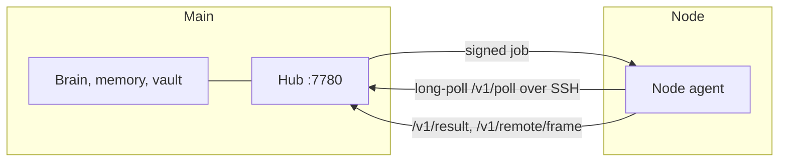

# Cluster

`cluster.main_device` in `jarvis.config.json` is the main: brain, memory, vault and the hub
on `127.0.0.1:<listen_port>`. Everything else is a node that long-polls the hub.

```sh
jq .cluster jarvis.config.json
python -c "from jarvis.platforms import detect; print(detect())"
```



## Config (`cluster`)

| Key | Default in code | This repo's value |
|---|---|---|
| `enabled` | `false` | `true` |
| `main_device` | none | `zenbook` |
| `tunnel` | `reverse` | `forward` |
| `listen_host` | n/a | `127.0.0.1` |
| `listen_port` | `7780` (`topology.DEFAULT_PORT`) | `7780` (7778 is the Grokbot tunnel) |
| `main_url` | `http://127.0.0.1:<port>` | `http://127.0.0.1:7780` |
| `auto_release` | `true` | not set |
| `ca_file` | none | not set |

Tunnel modes: `reverse` = the main runs `ssh -R` to each node (nodes need an SSH server).
`forward` = each node runs `ssh -L` to the main (only the main needs one).

## Commands

```sh
jarvis cluster roles
jarvis cluster main <id>
jarvis cluster init               # main, once
jarvis cluster invite <node>      # main; writes a file, refuses to overwrite one
jarvis cluster join <code>        # node
jarvis cluster doctor             # either side
jarvis cluster status | leave | revoke | caps
jarvis cluster update <node> [--rollback]
```

## Rules

- **After code changes nodes refuse mismatched code.** Run `jarvis cluster update <node>`.
  If a node is offline, say so and leave it. Do not keep retrying.
- Jobs carry the main's signature; nodes check it. Dispatched actions are never replayed.
- Nothing goes to the Dell unless David says it is available.
- A node is "alive" for 10 s after a check-in (`FRESH`).

## Clipboard sync

A watcher (`clipsync.py`) runs on each side; the cluster keep-alive restarts it if it
dies. Since the overhaul: `clipsync.stop()` leaves a marker so a stop by hand holds until
the next boot, and only one watcher can run per machine (`clipboard.lock`).

## Hub lockout, bundle gate, from= pin

A 429 is a failed hub auth, nothing else. `AuthBackoff` (`jarvis/cluster.py`) counts those
in a 300 s window: 5 from one source, or 50 from every source. Past that, the answer waits
`min(60, 2**(n-5))` s and says so in `Retry-After`. The global count delays every source.
A call with a valid owner or node token is served anyway, so a live node cannot be locked
out. The count clears after 300 s. It applies after a main/hub restart.

You see it on that refused call: status 429 and `Retry-After`. A good token still succeeds
in the same window, which is how this differs from a down node (`jarvis cluster status`).

`from=` on a node key is off unless you opt in. Off, `restrictions()` / `authorize()`
(`jarvis/cluster_setup.py`) write the same authorized_keys line as before. The pin has to be
an address the code already knows, and a value that could inject into the line is refused.
Config key: `cluster.pin_node_address: true` (in `jarvis.config.json`). Nobody has enabled it. Do not enable it for the Dell: its address changes between
LAN and Tailscale, and a wrong pin kills the tunnel.

The hub always serves a versioned bundle (`version` + `vsig`), and a node installs that.
A node that already installed one refuses a bundle with no version.
`LEGACY_UNVERSIONED_UNTIL` (`jarvis/deploy.py`, 2027-01-15 UTC) is the remaining hole: a
node that has never had a version still accepts an unversioned bundle until then, and
refuses one after. The hub keeps sending the legacy `signature` field so those nodes can
update. On a node, look for `cluster-code-version.json` in its state (`.jarvis/` on that
machine; the main does not have this file). When every node has it, delete the legacy
branch. The step up from this release is `tests/cluster/test_bundle_upgrade_path.py`.

Order: restart the main first, then `jarvis cluster update <node>` for each node that is
online. Leave one that is offline. The Dell only when David says it is available.
