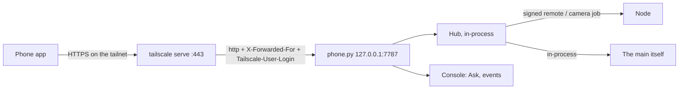

# Phone app

A small web app (a PWA) on David's phone that drives JARVIS over Tailscale. It is a remote
control for JARVIS, not a second JARVIS:

- **Devices**: every computer, online or not, what each can do now, session status.
- **Control**: the screen, mouse and keyboard of the main or a node (same sessions as the
  console's Remote view).
- **Camera**: a live view of a computer's webcam, 15 minutes at most.
- **Ask**: a request through the normal JARVIS pipeline, as if typed at the main. While it works,
  the phone shows the real decision path (see below).

Code: `jarvis/phone.py` (server, pairing, CLI), `jarvis/web/phone/` (the app),
`jarvis/camera.py`, `jarvis/locate.py`, session kinds and owners in `jarvis/remote_view.py`,
hub calls in `jarvis/cluster.py`. Tests: `tests/test_phone*.py`, `test_camera`,
`test_locate`, `test_remote_kinds`.

## How it is wired

- The server binds `127.0.0.1:7787` only (`phone.port` in config overrides; not 7790-7799,
  the overlay uses those). It starts inside the main's runtime (`jarvis-cluster`), only when
  the link is on, and a failure to bind never takes the console down.
- It is its own server with a fixed list of files and routes. It never falls through to the
  console on :7777, which trusts anything on loopback.
- Nothing new listens on a node: sessions and locating ride the existing hub and tunnel.

## Threat model

**A paired phone is owner-level.** Remote control is raw keyboard and mouse, and Ask reaches
the brain under David's rules. So pairing and every request are checked hard, and the phone
gets nothing beyond the five features: no shell, file or settings API.

Every request must pass, failing closed at each step:

1. `Host` is the main's tailnet name (or `127.0.0.1:7787` / `localhost:7787`).
2. `X-Forwarded-For` (set by Serve) is a tailnet address that `tailscale whois` knows.
3. `Tailscale-User-Login` (set by Serve) equals whois's login.
4. `Sec-Fetch-Site` is absent, `same-origin` or `none` (no other site can send it).
5. A POST carries `X-JARVIS-Phone: 1` and a JSON object of at most 256 KiB.
6. `/phone/api/*` carries the phone's cookie (`__Host-jarvis_phone`, HttpOnly, Secure,
   SameSite=Strict, 90 days). Only its SHA-256 is stored, and it works only from the same
   Tailscale device and login it was paired from. The cookie rotates: a non-frame request
   after 7 days mints a new one (`Set-Cookie`), and the previous one still works for 10 minutes.
   A frame request sends its session id in the `X-JARVIS-Session` header, not the URL
   (`?session=` is still accepted until 2026-12-31 for phones running an old cached page).

The whole server answers 503 to everything while the link is off, while Tailscale Funnel
reaches the port (the public internet), or while Serve's settings can't be read.

**Pairing** needs David at the main: `jarvis phone pair` prints an 8-character code (valid
5 minutes, stored hashed) to that terminal only. The phone sends it, and the terminal asks
`<device> (<OS>, <login>) wants to pair as '<name>'. Allow? [y/N]`. Only `y` pairs. The main
itself, any cluster computer and anything that isn't iOS or Android are refused before a code
is checked. Five wrong codes per device per 10 minutes, then a wait.

**What the phone can't do:**
- Approve anything. Confirmation words ("yes", "approve", "ok"...) are refused with
  "Approve on your PC", and a request that needs an OK says "Waiting for your OK on the PC".
- Take a session someone else holds. The console's or another phone's session answers 409;
  another phone's session ids read as unknown (404).
- Reach the brain with new powers. The brain gets no new tool. `camera`, `locate` and
  `remote` jobs are refused on `/v1/action` and `/v1/control` for every caller, the owner
  token included; only the console and the phone server start them, in-process.

**What the computer being watched shows:**
- A notification when the phone starts or ends control of its screen, when its camera turns
  on or off, and when the phone locates it.
- The camera needs that computer's own consent (`jarvis camera allow on` there), read from
  disk at every start and every frame. Infrared cameras are skipped.
- `jarvis control stop` there ends screen and camera sessions.

**Out of scope** (this design can't stop these):
- Unsandboxed code running as David on the main can forge loopback requests to the server or
  edit `.jarvis/phone.json`. That includes Grok's local exec and the desktop `computer` tool
  typing into a real terminal. `gates.hard_deny` refuses `jarvis phone|camera`, webcam and
  location commands, the phone port and paths, and `tailscale serve|funnel` changes. It is a
  speed bump, not a wall: string-built Python gets past it.
- A paired phone that is stolen and unlocked has David's access until it is revoked at the
  main (`jarvis phone revoke <id>`).
- Anyone who controls David's Tailscale account or the Tailscale client on the main.

## Setup (David runs these himself)

On the main (Arch, fish is fine for all of these):

1. `jarvis phone on`
2. `systemctl --user restart jarvis-cluster` so the server binds.
3. `sudo tailscale serve --bg --https=443 http://127.0.0.1:7787`. Tailnet only: **never**
   `tailscale funnel`.
4. `jarvis phone status`. Check `url`, that `serve_points_here` is true, `funnel` is false and
   `refusing` is null.

On the iPhone:

5. Turn Tailscale on, open the `url` from step 4 in Safari, then **Share > Add to Home
   Screen**. Open JARVIS from the new icon. iOS keeps the Home Screen app's storage apart from
   Safari's, so pair from the icon, not from Safari (the page says so if you try).
6. On the main: `jarvis phone pair` (optional `--name "David's iPhone"`). Type the code on the
   phone, then answer `y` at the terminal.

Camera:

7. Camera consent, once per computer whose webcam the phone may view, the main included:
   `jarvis camera allow on` (on that computer). `jarvis camera status` shows the camera it
   would open, ffmpeg and whether it's busy.
8. Nodes need the capabilities. When the Dell is available, on the main:
   `jarvis cluster caps dell --capability desktop --capability files --capability grokbot --capability inventory --capability camera`
   (it **replaces** the set, so list everything it should keep).
9. Nodes run the main's code: `jarvis cluster update dell` after these changes.
10. Windows camera: install ffmpeg so `ffmpeg` is on the node agent's PATH (for example
    `winget install Gyan.FFmpeg`), then restart the node agent. In Settings > Privacy &
    security, turn on Camera > "Let desktop apps access your camera".

## Turning it off

| To | Run |
|---|---|
| Refuse every phone request now | `jarvis phone off` (503 at once; unbinds at the next restart) |
| Cut one phone, or all | `jarvis phone revoke <id>` / `jarvis phone revoke all` (ids: `jarvis phone list`); its sessions end within 5 s |
| Stop publishing it on the tailnet | `sudo tailscale serve --https=443 http://127.0.0.1:7787 off`, or `sudo tailscale serve reset` (that one clears every Serve entry) |
| No camera on a computer | `jarvis camera allow off` there (a running view ends within a second) |
| No camera or locate on a node | `jarvis cluster caps <node> ...` again without `camera` / `locate` |
| End everything on a computer now | `jarvis control stop` there |

## Privacy

- **Camera** frames go only to the main's memory (newest frame wins) and the phone that opened
  the session. Nothing is recorded.
- **Events** on the console (`phone.paired`, `phone.revoked`, `phone.session`, `camera.on`,
  `camera.off`, `phone.locate`) never carry codes, keys, session ids or coordinates. Codes and
  cookies are never logged.

## Limits

| What | Value |
|---|---|
| Pairing code | 8 characters, 5 minutes; 60 s to collect the key after `y` |
| Wrong codes | 5 per device (and per address) per 10 minutes |
| Cookie | 90 days, rotated after 7 days (10 min grace for the old value), bound to the Tailscale device and login |
| Connections | 24 at once (503 above), one frame request per phone (429), 30 s socket timeout |
| Session quality | low by default from the phone |
| Camera presets | low 640x480 @ 5 fps, medium 960x540 @ 8, high 1280x720 @ 10 |
| Camera session | 15 minutes, then start again |
| Locate | 15 s on the computer; the main waits up to 25 s for a node |
| Ask | 2,000 characters; the first reply waits up to 3 s, then the phone long-polls (8 s, or sooner when a step lands) |
| Phone in the background | lets go at once, ends the session after 15 s (the hub's own `MAIN_IDLE` of 20 s is the real guarantee) |

## Ask: the decision path

While a request runs, Ask shows an expandable tree of what JARVIS is actually doing: memory recall,
route choice, planning, each planned job and each tool used. It folds to "How it got there" under the
answer, and stays open ("Where it stopped") if a step failed.

- **Source.** The console's own `turn.*` events (`jarvis/events.py`, channel `console`), kept per job in
  `phone.Trace` (48 jobs, 64 steps each) and sent as `trace` with `/phone/api/ask` and
  `/phone/api/ask/<job>?after=<rev>`. The poll returns as soon as a step lands (a short batching wait),
  so the tree moves with the work. No events means no tree, only "Working… N s"; nothing is invented.
- **What is not shown.** Reasoning text, tool arguments and output (tool steps show the tool name only),
  and the detail of failed steps. Labels and summaries pass `phone.redact`: tokens, passwords, URL
  credentials and queries and deep local paths are removed. The phone draws everything as text.
- **Who sees it.** Only the phone that sent the request; any other phone gets 404, as for the reply.
  Approvals still happen on the PC.
- **Retries.** The phone sends a `key` with each Ask. A retry after a lost reply carries the same key and
  finds the first request instead of running it twice. A request that failed on the PC retries as a new one.
  A saved job id (`jarvis.phone.ask`, 30 minutes) lets the app pick a running request up after a reload.

## Troubleshooting

| The phone says | Check |
|---|---|
| "Can't reach JARVIS — is Tailscale on?" | Tailscale on the phone; the main awake; `jarvis phone status` (`listening`, `serve_points_here`) |
| "JARVIS's phone link is off" | `jarvis phone on`, then restart `jarvis-cluster` |
| "Tailscale Funnel publishes JARVIS to the internet" | Funnel reaches port 7787. Turn it off, then set up Serve again (step 3) |
| "JARVIS can't read Tailscale's serve settings" | `tailscale serve status --json` must work as David, without sudo |
| "Tailscale serve did not forward the client address" | Something other than Serve proxied the request. Use the Serve command above exactly |
| "Unexpected Host header" | Open `https://<main>.<tailnet>.ts.net/`, not an IP address |
| "That Tailscale login doesn't match this device" | The phone must be signed in to Tailscale as David, not as a tagged device |
| Pair screen again after it worked | Opened in Safari instead of the Home Screen icon; the phone was revoked; or Tailscale was reinstalled on it (new device id). Pair again |
| "Only a phone can pair with JARVIS" | Tailscale reports a desktop OS. `--allow-desktop` is for testing only |
| "Too many wrong codes" | Wait 10 minutes, then `jarvis phone pair` again |
| "Someone else is already controlling that computer" / "watching that camera" | The console or another phone holds it. End it there |
| "The camera is off for JARVIS on this computer" | `jarvis camera allow on` on that computer |
| "The camera is in use by another app" | Close the app holding it. On the Arch main, Zen browser can hold `/dev/video1` |
| "ffmpeg isn't installed on this computer" | Step 10 (Windows), or install ffmpeg |
| "Windows wouldn't open the camera" | Settings > Privacy & security > Camera, desktop apps on |
| "Runs older JARVIS code" | `jarvis cluster update <node>` |
| "Approve on your PC" / "Waiting for your OK on the PC" | By design: answer at the console gate or say "Jarvis, yes" |
| Session ends soon after switching apps | By design: a phone in the background stops watching |

Not yet checked on a real tailnet: that Serve keeps the `Host` header and sets
`X-Forwarded-For` (both taken from Tailscale's source). After setup, run
`jarvis phone status` and make one request from the phone. If every request fails with
"did not forward the client address", tell Claude.

## Choosing the computer for Ask

Use **Ask > Send to** to choose the main or an online node (for example Dell).
The selection is remembered on this phone. Requests without an explicit PC act on the
selected computer; an explicit computer name still takes priority. The main interprets
requests and uses the existing signed node channel for execution. Offline, unenrolled,
and outdated nodes return a concrete error. Retries remain bound to the original target.
Approvals stay on the main, and the phone cannot approve them.

Native application requests use native app launch, accessibility and the target PC's
keyboard/mouse tools. Spotify's tool instructions prefer native search followed by
verified selection; they no longer require a Chrome search to obtain a track ID.

## Per-request usage and cost

Expand **Usage & cost** below an Ask reply to see reported tokens, model calls and the
API-equivalent USD estimate. This is a comparison value, not an additional subscription
charge. While a request is running the section explains that totals are pending; if usage
was not reported, it says so instead of presenting a made-up zero. Provider usage can be
incomplete. Local requests are labelled as having no metered model calls.

Spotify accessibility snapshots now allow up to ten seconds for enabled interactive controls
(the first window alone is not readiness). They return immediately when controls are ready.
Other native apps can opt in with `app_ui snapshot` and `wait_ready` from 0 to 15 seconds.
Only read-only snapshots are retried; clicks and typed input are never repeated by this wait.

## Mobile location removal and MAIN management

Location/Radar, Locate, Maps links and mobile geolocation have been removed. The mobile
overview excludes location coordinates/capabilities, and `/phone/api/locate` returns404.
Other non-mobile location tools are unchanged.

Mobile MAIN promotion/preference/recovery is planned in
`docs/design/mobile-continuity/DESIGN.md`; it is not implemented by changing a config file.
It requires single-MAIN fencing, candidate readiness, explicit fleet-admin authentication
and a visible handover operation. Ordinary mobile commands continue through MAIN.
