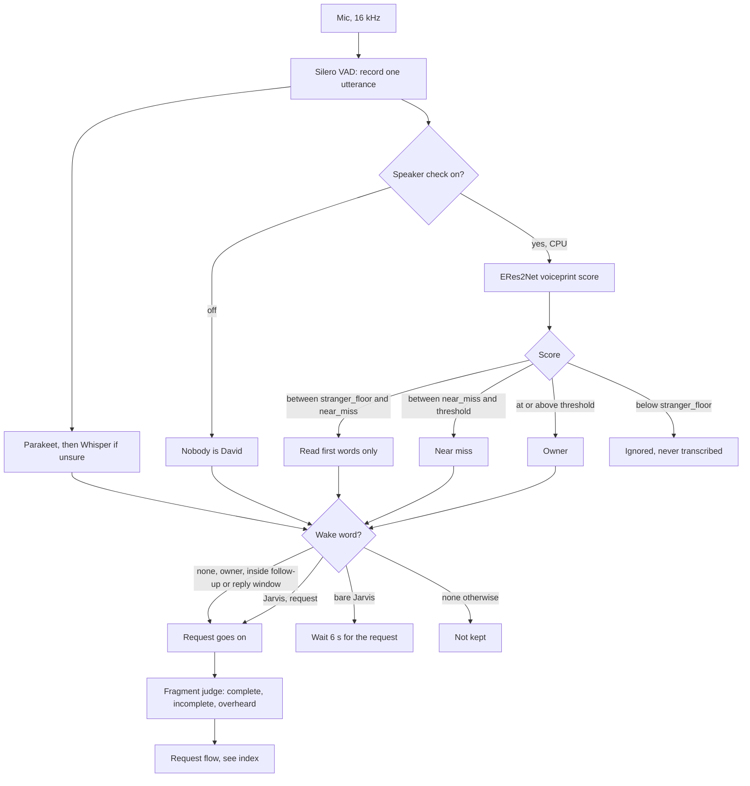

# Voice

JARVIS listens for "Jarvis, ..." on the main. A speaker check decides whose voice it
is, a speech-to-text engine decides what was said, and the wake word decides whether it
was meant for JARVIS.

## Pipeline



Facts, from `daemon.py` and `listen.py`:

- On a CUDA machine the voice check and transcription run side by side. On CPU the
  check goes first so a stranger's clip never queues ahead of David.
- A stranger's words are discarded unread unless the first `HEAD_SECONDS` open with the
  wake word.
- A near miss only counts when the clip also starts with "Jarvis".
- A follow-up (6 s after a bare "Jarvis") and a reply to JARVIS (8 s after it stops
  talking) need no wake word, but only for a full owner match. Approving or cancelling a
  confirmation always needs "Jarvis".
- The voiceprint learns from a clip only when it was an owner clip, said "Jarvis" in that
  clip (not a follow-up), and `voice.adapt` is not false.
- If the mic dies, `reopen_after` closes it quietly and the loop reopens it. Nothing is
  spoken and the failure counter does not move.

## Wake word

Accepted: jarvis, jervis, jarvas, javis, jarvus, jarviss, jarves (`assistant.WAKE_WORDS`),
plus Parakeet mishearings jovers, jarbus, jovis (`listen.WAKE_VARIANTS`) and a fuzzy match
that Whisper then confirms. A lead-in such as "hey" or "okay" is allowed.

Measured offline on 2026-11-07 (248 wake clips, 90 others; `jarvis.voice_eval`):

| Path | Recall | False wakes | p95 latency |
|---|---|---|---|
| Parakeet alone | 83.1% | 0 | 0.57 s |
| plus variants | 84.3% | 0 | 0.57 s |
| plus fuzzy match, then Whisper | 93.6% | 1.1% | 2.27 s |
| always-on path | 98.8% | 1.1% | 2.77 s |
| Whisper alone | 96.4% | 1.1% | 2.21 s |

Speaker check on the same run: EER 0 on 77 positives against 92 negatives. At 0.36 it
rejects every negative and 1 of 77 positives (FRR 1.3%).

## Config (`voice` in jarvis.config.json)

| Key | Default | Meaning |
|---|---|---|
| `speaker_check` | `true` | `false` = nobody is taken for David; every request needs "Jarvis", nothing is learned |
| `near_miss` | `0.25` (`BORDERLINE`) | Score floor for a near miss |
| `stranger_floor` | `0.08` | Below this the clip is never transcribed |
| `adapt` | `true` | Let the voiceprint learn from good clips |
| `speaker_model` | file next to the voiceprint | Path to the ERes2Net model |
| `stt_engine` | `parakeet` | `parakeet`, `moonshine` or `whisper` |
| `stt_model` | `large-v3-turbo` | Whisper model |
| `language` | `en` | |
| `moonshine_model` | `base` | Only with `stt_engine: moonshine` |
| `engine` | set in this repo's config: `elevenlabs` | Speech output; `kokoro` is local and free |
| `kokoro_voice` | `bm_lewis` here | `jarvis voice demo`, `jarvis voice use <name>` |
| `monthly_char_budget` | `30000` (ui falls back to this) | ElevenLabs characters per month |
| `max_spoken_chars` | `350` here | Spoken length cap |

The learned threshold is clamped to `FLOOR 0.30` .. `CEILING 0.36` (`Voiceprint`); David's
live scores run 0.38 to 0.45.

## Push-to-talk differs from the daemon

With `speaker_check: false`, the daemon needs "Jarvis" for every request. Push-to-talk in
the console (`ui.transcribe`) returns the transcript without it (`owner=False`,
`addressed=False`). Tested as-is; David decides whether to align them.

## Commands

```sh
jarvis voice enroll | test | recalibrate     # voiceprint
jarvis voice start | stop | status           # background listener
jarvis voice autostart on
jarvis voice demo | use bm_george            # Kokoro voices
.venv/bin/python -m jarvis.voice_eval [--quick] [--download] [--no-whisper]   # offline, ~16 min full
```

`voice_eval` uses recorded and synthetic clips only. It never opens the mic.
