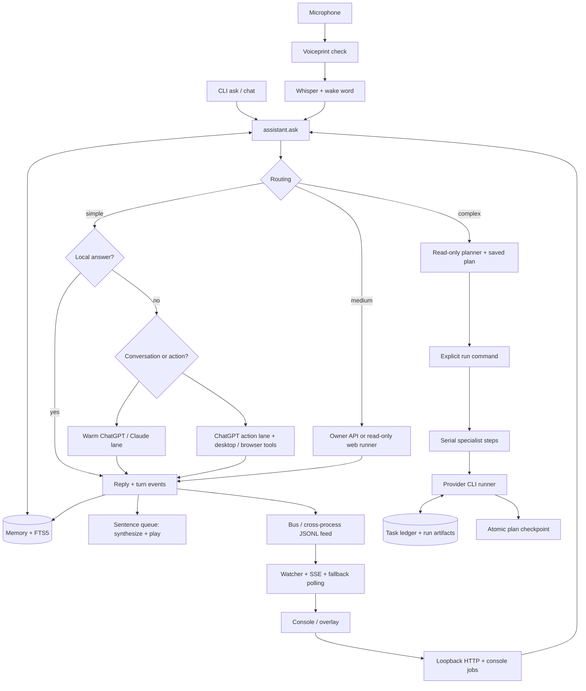

# JARVIS workflow review and pipeline optimization

Date: 2026-10-21. Scope: the source tree in `C:\Users\jdoe\Desktop\JARVIS`.

Follow-up: [phase 2 hardening](pipeline-hardening-phase2.md) implements local plan
locking, explicit recovery, deterministic copy-collision fixes, live subscription
quota reporting, and microphone cleanup. Its report and latest test evidence
supersede the corresponding unfinished-work items below; this document preserves
the original phase 1 measurements.

## Recommendation

Keep JARVIS as a modular local application with SQLite, warm model processes, streamed speech, and a serial task runner. Its main weaknesses are incomplete recovery and lifecycle management, growing read/retention costs, and documentation that mixes earlier milestones with current behavior. Adding more services or models would increase operational work before fixing those weaknesses.

This review implements six focused production-file changes, adds thirteen regression tests, fixes one test-process pipe cleanup, and downloads two architecture skills. The independent reviewer found no blocking regression. Existing routing, provider configuration, voice settings, browser permissions, and the serial task constraint are preserved. No user data was deleted or migrated.

## Operating assumptions and review coverage

This is a personal assistant for one owner across a Windows laptop and an SSH-connected Arch laptop. Priorities are prompt conversation, reliable local state, recoverable work, and predictable resource use. Public hosting, multiple tenants, and distributed high availability are outside the observed requirement.

Reviewed the entry points, orchestration and task execution, warm provider protocols, memory queries, live event delivery, speech/listening boundaries, console jobs, file-transfer paths, provider credits, device probes, launchers, configuration/package declarations, documentation, and corresponding tests. Frontend review traced HTTP/SSE consumers and refresh behavior; it was not a visual design audit. Hardware/integration modules were inspected at their boundaries, not exercised on real devices.

Private `.jarvis` data, provider session contents, secrets, microphone recordings and browser profiles were not audited. Offline tests use temporary databases, mock services and fake Python provider processes. Live model latency, browser actions, GPU transcription, physical audio and SSH behavior remain unverified by this change.

Capacity assumptions for planning, not measured usage: 100 requests/day is about 0.0012 average requests/second, with bursts of a few local requests. At 4 KB per exchange, raw conversation text is about 146 MB/year before indexes and metadata. At 100 unique eight-second, 24 kHz, 16-bit mono replies/day, an unpruned WAV cache could grow about 14 GB/year. Audio, logs and artifacts deserve retention controls sooner than the task database deserves sharding.

## Current workflow



With conversational routing and `auto_escalate` disabled, normal conversation stays on the brain. Explicit tiers or configured escalation use the larger workflow. A one-shot `ask` creates and closes its lane; console, interactive chat and listener processes can keep lanes warm. The console and listener are separate processes and can each own their own brain/model resources.

| Area | Main code | Assessment |
| --- | --- | --- |
| Commands and launch | `__main__.py`, `start.bat`, `overlay.py` | Several entry points over the same application. Interpreter selection needs one documented setup contract. |
| Routing and prompts | `assistant.py`, `router.py`, `prompts.py`, `instant.py`, `.claude/agents/` | Cheap routing and explicit plan execution are useful. Keep acceptance criteria separate from a successful process exit. |
| Provider execution | `chatgpt.py`, `fastlane.py`, `runner.py`, `adapters.py`, `actions.py` | Warm processes reduce repeated startup work. Failed-stream isolation and deadline enforcement were the immediate reliability fixes. |
| Durable state | `store.py`, `memory.py`, `orchestrator.py` | SQLite/FTS5 suits the scale. Plan JSON and the task/memory databases are separate commit boundaries, so recovery needs reconciliation. |
| Live console | `ui.py`, `events.py`, `web/app.js`, `web/dashboard.js` | SSE plus authoritative API reloads is sensible. Overview reads were wasteful; overflow and rollover need explicit recovery tests. |
| Voice | `listen.py`, `daemon.py`, `speech.py`, `voice.py`, browser recorder/worklet | Owner verification precedes transcription; synthesis overlaps playback. Queue shutdown, interruption, cache limits and shared budget accounting remain incomplete. `voice.py` serves a separate MP3 command; it is not simply dead duplicate code. |
| Devices and files | `probe.py`, `inventory.py`, `devices.py`, `desktop.py`, `transfer.py`, `storage.py`, `selftest.py`, `web/files.js` | Keep fixed SSH collectors, trusted host keys and device boundaries. File collision handling needs stronger guarantees before concurrent copies. |
| Usage and presentation | `credits.py`, web graph/terrain/theme assets | Distinguish live, locally estimated and manual usage. Retain lazy/cached reads; don't make external-provider health a requirement for chat readiness. |

## Implemented optimizations

| Change | Why it matters | Compatibility and limits |
| --- | --- | --- |
| Both warm lanes enforce explicit monotonic deadlines before reading another event. | Previously a constantly nonempty output queue could run indefinitely past the configured timeout. System clock adjustments no longer distort these timers. | Startup has separate budgets. Blocking tools, callbacks and stdin writes are not made cancellable here. Cleanup may add several seconds. |
| Abandoned turns discard their process and output queue. | A reproduced Claude failure returned a previous turn's leftover answer on the next request. Callback failures could similarly leave ChatGPT output pending. | Successful turns still reuse the warm process. Intended overload fallback behavior remains. Already-spoken partial text cannot be recalled. |
| Shared direct-child cleanup waits after kill; reader threads close stdout. | Prevents the observed lane resource leaks and leaves clean state for the next request. | Descendant MCP/browser processes are not fully managed by this helper; process-tree ownership is follow-up work. |
| `Store.overview()` fetches totals and only the fourteen recent task projections using one connection. Added a timestamp index. | Replaces two full Python task lists and up to fourteen individual task reads. Preserves the console response and objective truncation. | State totals still aggregate the ledger; this is not an O(1) counter. The index is additive and built on Store initialization. |
| `runner.final_message()` iterates JSONL lines. | Avoids loading and splitting the complete provider transcript just to extract its final answer. | Memory is bounded by the largest line and retained answer, rather than the whole log. Codex's existing last-message file behavior remains. |
| Plan snapshots use temporary-file flush/fsync and replacement. Completed results are saved before memory indexing. | An indexing error no longer discards the execution checkpoint or causes successful work to replay on resume. Readers see a complete old or new plan. | A recorded dispatch with no result now refuses automatic rerun. This intentionally favors inspection over duplicate side effects; there is no exactly-once guarantee. |

The plan store, task ledger and memory database are still separate stores. If indexing fails after the result checkpoint, execution is preserved but the result may need memory-index repair. A crash after dispatch but before the result checkpoint leaves an uncertain step requiring manual inspection. Do not clear its task mapping just to make Run work again.

## Measurement and verification

Baseline: **183 tests passed** in 35.333 seconds. Final verification: **196 tests passed** in 37.061 seconds with warnings enabled and no observed resource warnings. An earlier full run exposed an existing unclosed pipe in the local-server test harness; its cleanup was corrected before this final run. The complete result and interpreter path are recorded in `audit-evidence/final-tests.txt`.

The thirteen new tests cover stale Claude output, callback failure in both lanes, process/pipe/reader cleanup, post-kill reaping, busy-stream deadlines, overview response/query compatibility, streaming log extraction, plan-memory failure, failed execution, uncertain dispatch, and atomic replacement failure. The auditor also ran eight separate edge-case checks and the existing 33-test pipeline suite. See [the independent audit](pipeline-independent-audit.md).

Synthetic task-summary benchmark, fifteen alternating samples per implementation, same local temporary database, medians:

| Ledger size | Previous task-summary path | Updated path | Ratio |
| --- | ---: | ---: | ---: |
| 100 tasks | 4.932 ms | 0.394 ms | 12.53x |
| 10,000 tasks | 36.675 ms | 3.661 ms | 10.02x |

Both implementations returned equal responses. This isolates task-summary reads; it is not an end-to-end dashboard, model, speech or cold-start benchmark. The old query code was reproduced against the current temporary schema, so the comparison does not inflate the gain by removing the new index from the old path.

Reproduce from the project root:

```powershell
python -m unittest discover -s tests -v
python -m unittest discover -s tests -p test_pipeline_optimizations.py -v
python docs/audit-evidence/benchmark_task_overview.py
```

## What to add next, in priority order

| Priority | Addition | Evidence / reason | Completion check |
| --- | --- | --- | --- |
| 1 | Plan lease and explicit recovery command | `Orchestrator.run` has no whole-plan cross-process claim. Two processes can load the same snapshot before either saves. The serial task index alone cannot guarantee one plan execution. | Two processes attempting the same plan produce one owner; recovery inspects task state/artifacts and never blindly reruns possible side effects. Add idempotent memory-index repair. |
| 1 | Enforced approval for consequential browser actions | `actions.approve_browser` checks server/tool/URL, but generally permits browser clicks and typing. Restrictions on sending, buying or deleting primarily live in model instructions. | A tested policy distinguishes inspection from consequential actions and binds owner confirmation to the exact action. Do not increase browser authority while relying only on a prompt. |
| 1 | Atomic destination reservation for copies | `storage.copy` picks names using a listing capped at 3,000 entries, then sanitizes a Windows filename after collision selection. Both storage/drop copies use check-then-copy operations. | Concurrent copies and names that collide after sanitization cannot overwrite existing files; oversized listings cannot hide a collision. Preserve existing files during all failure paths. |
| 2 | Stage timing and failure categories | Existing turn durations combine startup, recall, inference and delivery. They cannot show which stage dominates. | Track monotonic routing/recall/startup/first-token/first-sentence/full-reply/TTS timings by request ID; report p50/p95 and failures, without logging credentials or raw audio. |
| 2 | Feed rollover identity and overflow recovery | `Watcher._poll_feed` checks size only; `Bus.publish` drops on a full queue while SSE may stay connected. | Equal/larger replacement and slow-client tests trigger explicit resync; complete authoritative history is eventually displayed. |
| 2 | Retention and controlled shutdown | `Console.jobs` and speech queues have no terminal-item/queue lifecycle policy. Audio cache and listener log can grow indefinitely. | Configurable limits preserve active jobs and in-use audio; stop/drain semantics are tested. Start with dry-run retention reporting, then deliberate cleanup. |
| 2 | Reproducible setup, version control and offline CI | This workspace has no `.git` directory. `pyproject.toml` voice extras omit the default Kokoro engine, and `start.bat` assumes a particular MiniConda path. No CI configuration was found. | Fresh Windows install selects one interpreter, verifies optional dependencies/model files, and runs the offline suite. Initialize version control only as a deliberate project setup step; add CI once a repository host is chosen. |
| 3 | Narrower application interfaces | `ui.py` combines HTTP, jobs, memory/cases, graph generation and integrations. `Console.history` still issues a reply query per message. | Extract a conversation read model or job controller when changing that area; preserve API contracts and profile before broader rewrites. |
| 3 | Single-flight credit refresh | `Credits.all` caches results but concurrent cold/forced requests can duplicate provider calls; providers are visited sequentially. | Reuse in-flight refresh work; publish stale-but-labelled data while refreshing; verify failures remain isolated per provider. |

Do not enable parallel writers until path overlap detection, ownership, whole-plan claims, independent workspaces and acceptance verification are in place. Current `owned_paths` validation only catches equal strings, not parent/child overlaps or aliases.

## What to remove or consolidate

- **Removed now:** duplicate task-list reads, per-task overview lookups, whole-log materialization, and reuse of failed conversation streams.
- **Corrected stale README documentation:** removed statements that no dashboard or conversational loop exists, replaced the old 39-test claim with a link to current validation, and clarified task/plan recovery. Historical measurements elsewhere remain labelled by date; the current live hardware/provider state was not revalidated here.
- **Exclude generated artifacts from a future repository:** `jarvis.egg-info/`, `__pycache__/`, `.pytest_cache/` and browser test artifacts. Keep `.jarvis/` private and backed up appropriately; it contains valuable state and may contain credentials. No directories were deleted during this review.
- **Consolidate resource ownership before feature growth:** multiple console/overlay/listener processes can each warm their own providers and speech models. Measure memory and startup costs, then consider one local coordinator if duplication proves significant. This is a design option, not a migration performed here.
- **Defer unconfigured integrations:** keep Muse/Grokbot/Jev interfaces labelled as unavailable until their input/output contract and authentication are verified. Removing a displayed placeholder is a product choice; adding another provider does not repair workflow reliability.

Keep working fallbacks, the direct MP3 export command, SQLite/FTS5, serial execution, explicit plan approval, the two-stage speech pipeline and periodic authoritative resync. There is no demonstrated need for microservices, Kubernetes, Redis, a vector database or a distributed scheduler in the current workload.

## Skills used and design checklist

Downloaded [system-design](../skills/system-design/SKILL.md) and [architecture-patterns](../skills/architecture-patterns/SKILL.md), with their references and MIT licenses. Selection considered adoption, repository history signals and actual content; see [sources and availability](../skills/README.md). Their requirements-first and module-boundary guidance informed this review. No directory-layer rewrite or runtime dependency was added.

Using the system-design skill's eight-row diagnostic strictly as **documentation/readiness coverage**, the post-review assessment is **6/10 (5 of 8 rows)**: local requirements, illustrative capacity estimate, an explicit SQLite-first growth strategy, existing read caches, and existing async queues are covered. The three gaps are component redundancy, an operational monitoring/alerting plan, and repeatable deployment/rollback. For this single-owner local application, address these with tested backup/restore, stage metrics/local health signals, and a reproducible environment plus versioned rollback. Do not add multi-region replicas just to improve this rubric. This is not a measured reliability or performance score.

## Rollout and rollback

Already-running JARVIS processes retain their loaded Python code. Apply these changes by restarting the console/listener/overlay at a convenient idle point, after any active task has finished. The review did not stop or restart the user's running applications.

The only schema addition is the task timestamp index, created on the next Store initialization. Existing task records, memory and plan formats remain compatible. The intentional behavior change is refusal to automatically retry an uncertain plan step.

Pre-change copies of the six production modules are in `%TEMP%\jarvis-pipeline-baseline-20261021`; a unified diff is stored at `audit-evidence/production-changes.patch`. To roll back, stop active work, restore those six source files and restart JARVIS. The additive index can remain. Do not restore or delete `.jarvis` data to roll back code. The temporary backup is not a substitute for permanent version control.
